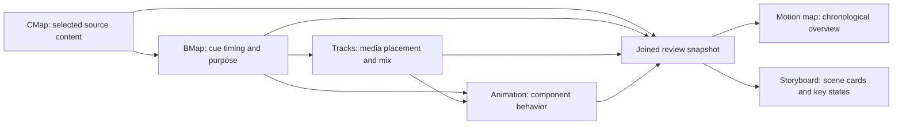

# fluxo-de-edicao compared with AVO

Research recorded 2026-11-04. These are product recommendations, not implemented
features or new operating rules. Proposed backlog scope is indexed in
[the roadmap](ROADMAP.md#editing-craft-and-motion-planning-research-proposals).

## Finding

The useful import is editing craft and a more concrete creator review experience.
AVO already implements most of the reference's workflow foundations. The largest
opportunities are a combined motion planning view and optional, reviewable camera
movement for talking-head footage.

The reference is deliberately a workflow-building skill. Its entry skill conducts
an interview, analyzes references, and writes personalized stage skills. Scripts
are to be written on the first real video. Its inspected tree contains 22 files:
21 Markdown documents and an MIT license, with no packaged renderer, executable
services, schemas, tests, or reusable implementation to integrate. Calling it
only a collection of prompts understates its practical craft guidance; treating
its described scripts as already available features would overstate it.
[Repository](https://github.com/LeiteZ/fluxo-de-edicao/tree/7339da3eba9eedcc8d5319c93f8c67eb300512fa),
[entry skill](https://github.com/LeiteZ/fluxo-de-edicao/blob/7339da3eba9eedcc8d5319c93f8c67eb300512fa/SKILL.md).

## Evidence and limits

- Reference revision: `7339da3eba9eedcc8d5319c93f8c67eb300512fa`.
- AVO baseline: `36591845f0ec896ed6c26d3e006f4dc007d52d1b`, on the existing
  `feature/avo-ways` branch, plus the current working tree.
- AVO already had substantial unrelated edits, including Resolve/OTIO import.
  Those edits were inspected as current work, not assumed released or accepted.
- The core Tracks, Animation, Shorts punch-in, event-clock, artistic-direction,
  and beat-edit capabilities cited below also exist in the baseline commit.
  This does not certify an installed binary or every rendering route.
- Compared reference guides/templates with AVO code, schemas, tests, command
  references, active specifications, and backlog. Absence means no equivalent
  native flow was located in that inspected scope, not proof none can be authored.
- Project memory search was attempted through the available CLI, but its service
  returned HTTP 502. Prior decisions beyond repository evidence remain unverified.
- The reference's render timings, visual-quality claims, software-specific XML
  details, and HyperFrames workarounds were not independently reproduced.

## Format diagnosis for the camera recommendation

This is a proposed capability for speech-led talking-head explanation, analysis,
or review, optionally mixed with screen demonstrations and graphic overlays.
The viewer primarily wants to understand an argument or see a demonstration;
creator personality may also matter. Motion supports that promise and readable
emphasis. Start at density Level 1 or 2, allow static sections, and vary by format.

No actual episode, title/thumbnail, audience, traffic posture, emotional arc,
source quality, brand, audio, aspect ratio, frame rate, duration, delivery target,
or publishing deadline was supplied. Resolve those in a real video's existing
diagnosis; this research does not prescribe a universal edit. Mobile readability,
headroom, source crop margin, evidence visibility, source rights, privacy, and
motion accessibility constrain the treatment. Use the existing review gates.

This does not select or migrate a motion engine. Preserve the recorded engine
and inspect actual route capabilities when implementing a video. Camera movement
of original footage and the virtual camera inside a graphic are distinct jobs.

## Capability and roadmap comparison

| Reference knowledge | AVO evidence today | Disposition |
| --- | --- | --- |
| Stage-specific skills, durable state, restart/resume | Native pipeline, canonical timeline revisions, command ownership and lifecycle in [workflow](avo-workflow.md), [pipeline service](../src/avo/timeline/pipeline.py) | Already covered; retain native services rather than generating another workflow/state file. |
| Human approval and invalidation after cut changes | [BMap service](../src/avo/timeline/bmap_service.py), [Animation service](../src/avo/timeline/animation.py), [review](../src/avo/timeline/review.py) | Already covered with exact dependency identities. |
| Separate audio/video tracks | [Tracks schema](../schemas/avo.tracks.schema.json), [Tracks service](../src/avo/timeline/tracks.py), `tracks inspect/resolve/render` in [CLI](../src/avo/cli.py) | Native implementation exists. Improve human presentation and export conventions, not the basic track model. |
| Motion map before asset search/render | BMap cue timing/intent/review states; Animation component lifecycles; [motion reference](../agent-skills/avo-pipeline/references/motion.md) | Foundation exists. BL-020 proposes a joined, creator-facing motion plan. |
| Detailed motion storyboard | [Animation system](animation-system.md), [promo](templates/animation/storyboard-product-promo.md) and [vertical](templates/animation/storyboard-short-form.md) templates | Already policy/templates; BL-020 adds a generated, linked talking-head review view. |
| Zoom in/out, pull-backs and camera moves coordinated with overlays | [Shorts fidelity punch-ins](../src/avo/shorts_fidelity.py), [Shorts plan](../src/avo/shorts_plan.py); beat-edit `punch_zoom` recipes | Partial and route-specific. No general talking-head camera planner/compiler was located. BL-021. |
| Measured style from reference clips | [Direction/Briefstart](provider-direction.md), [reference inputs](../agent-skills/avo-pipeline/references/briefstart.md), [beat-edit](../src/avo/beat_edit.py), [vision labels](../src/avo/beat_edit_vision.py) | Selection, provenance and technique labels exist. Quantitative camera/element motion analysis is a separate gap: BL-022. |
| Motion events drive sound, including transient alignment | [Event clock](../src/avo/timeline/event_clock.py), [waveform analysis/verification](../src/avo/adapters/media/waveform.py), [sound reference](../agent-skills/avo-pipeline/references/sound.md) | Core timing, cached onset analysis, reviewed markers and leading-silence trimming exist. BL-023 adds library metadata/matching rather than another analyzer or audio clock. |
| SFX library with attack, useful duration, brightness, favorites | [Synthetic effects](../src/avo/generate_sfx.py), [media resolution](../agent-skills/avo-pipeline/references/media.md), [library search](../src/avo/library/search.py) | Existing assets/search are useful foundations; no equivalent acoustic SFX catalogue/matcher was located. BL-023. |
| Spoken editing notes delimited during recording | Source-anchored decisions and [cutting service](../src/avo/timeline/cutting_service.py) exist | No dedicated, configured note extraction/routing flow was located. BL-024. |
| Phrase-first reading, words only on demand | [Transcript packing](../src/avo/pack_transcripts.py), [on-demand filmstrip/waveform](../src/avo/timeline_view.py), cutting context | Already covered; retain bounded reads. |
| Retake selection, uncertain boundaries, missing ASR speech | [Retake selection](../src/avo/timeline/cutting_retakes.py), [boundary checks](../src/avo/timeline/cutting_boundaries.py) | AVO already has stronger evidence checks. Do not replace them with a last-take/text-only heuristic. |
| NLE handoff with stable lanes, markers, original sources and stereo | [BL-017](../specs/backlog/nle-exports.md); current [Resolve import work](resolve-timeline-import.md) | Strong match to planned exports. Import work is a separate direction and is not proof of round-trip/export support. |
| Whole-film concept before expensive work; execute by section | [BL-011 composition planning](../specs/backlog/composition-command.md), existing storyboard guidance and scoped proof review | Extend BL-011/BL-020; section review cannot imply full-program approval. |
| Taste separate from craft, reusable learned patterns | Provider `DESIGN.md`, [Direction](provider-direction.md), [provider animation service](../src/avo/timeline/provider_animation.py) | Already covered. Do not create a competing profile catalogue or infer provider approval from one film. |

## Audio/video tracks: what exists and what is missing

`edit/timeline/tracks.json` is canonical assembly state, not merely a label in a
skill. Audio roles include dialogue, source audio, music, SFX and ambience, with
regions, gains, fades, ducking, channel selection and provenance. Video roles
include base footage, inserts, graphics, captions and other layers, with regions,
z-order, fit/crop, placement/compositing declarations and animation links.

Tracks connect to BMap cues and exact source identities. `TracksService.inspect`
returns audio/video layers and hierarchy findings. Compiler, mixer and integration
tests exist. Supported behavior still depends on the rendering route; schema
acceptance alone does not establish that an arbitrary transform will render.

The reference's V1 camera / V2 screen / V3 full-frame motion / V4 overlays / A1
voice arrangement is a helpful editor convention. AVO should offer a consistent
role-to-lane view and NLE mapping while preserving current layer IDs, roles and
z-order. Physical lane numbers are output conventions, not universal semantics.
Keep captions and mixed source audio explicit. BL-005's locale audio delivery is
a different concern from these editable production tracks.

## Motion map and storyboard: one plan, two views

Recommend both, alongside CMap/BMap, as projections of existing canonical state:

BMap remains the owner of cue timing. Tracks own assembly; Animation owns
behavior and lifecycle, and explicitly rejects owning cue timestamps. A motion
map must not become another independently editable timing authority.

| Review view | Creator sees | Authority |
| --- | --- | --- |
| Motion map | Section, time/duration, stable cue label, spoken trigger, purpose, visual treatment, camera intent, sound relationship, asset readiness and review status | Exact CMap/BMap/Tracks/Animation revision set; source/word anchors are evidence or rebase hints. |
| Motion storyboard | One card per beat: concept, background/middle/foreground, face/overlay layout, pre-entry, entrance, hold, payoff, exit, camera before/during/after, reading time, sound and risks | References the same cues/components and frozen revision set. Planned sketches are labeled separately from inspected rendered frames. |

Show the map at motion planning and the storyboard for substantial motion or
complex interactions, with the opening examined early. Do not force a dense
opening or a storyboard for every tiny overlay. Include purposeful no-motion
decisions; never fill blank time just to make a map look busy.

Requests such as "mo04 slower" or "cam07 remove" should resolve to stable IDs,
show the affected scope and use native revisions. Pretty labels must not become
unstable row numbers. After changes, regenerate the views and surface stale or
ambiguous items. Existing approvals remain scoped to what was actually reviewed.

Planning must also work before media is resolved. Show unresolved assets and
unplaced cues honestly; do not require a render-ready Tracks/Animation revision
just to discuss a concept or fabricate a source fingerprint. The first useful
slice is a text map and storyboard cards. Thumbnails and a visual track strip
can follow without building a new editor.

## Useful camera techniques to offer

The reference's [camera guide](https://github.com/LeiteZ/fluxo-de-edicao/blob/7339da3eba9eedcc8d5319c93f8c67eb300512fa/guias/etapa-camera.md)
provides the clearest product opportunity. Offer deliberate punch-ins, slow
push-ins, pull-backs to the original wide shot, overlay-aware reframing, and
optional face anchoring as selectable treatments, with a no-camera choice.

Reuse these practical checks:

1. Start a movement from the actual preceding transform; never jump to an
   unrelated scale or position before animating.
2. Keep one owner per animated transform property. Compose any approved base
   drift and emphasis deliberately, with explicit conflict handling.
3. Preserve headroom and eye placement, clamp to available source margins, and
   protect captions, products, UI and evidence. A portrait crop is not face
   tracking; do not infer tracking from an avoidance flag.
4. Plan face placement with the overlay. Do not move the person for a bottom
   caption band or animate footage hidden beneath a full-frame insert.
5. When motion continuity is intentional, match direction/velocity across the
   graphic-to-presenter handoff. Static returns are also valid.
6. Preview a numbered move in context before applying it across a video.
   Camera changes invalidate dependent composite/sound evidence as appropriate.

Scale must use real source/output geometry. A 1.25x crop of an output-sized
source requires resampling; a larger source may have genuine crop headroom.
Returning wide means the original framing, not exposing blank borders. Reuse
resolution/fidelity policy and disclose quality tradeoffs; BL-001/002 do not
become prerequisites or implicit authorization to upscale.

The current native Shorts implementation applies bounded fixed-scale windows.
That is useful prior art, but it is not a general eased camera path, word-driven
planner, face tracker, or long-form talking-head feature. Beat-edit recipes are
music-led and should not dictate speech-led timing.

## Other tips worth retaining

| Tip from the reference | AVO action |
| --- | --- |
| Describe the visual concept before choosing a template; use real demonstrations when available | Reinforce in BL-011/020 using current evidence, design and rights guidance. |
| Plan the entire film, then render selected sections without repeating treatments blindly | Show cross-section repetition and readiness in BL-020; retain the current dependency/invalidation model. |
| Exact cut boundaries and spoken triggers are different anchors | Expose both in the map; snap cut-bound elements through existing rational clocks, not rounded word times. |
| Asset choices on one numbered contact sheet, against the intended background | Add to planning/asset-review guidance; reuse image/grid tooling and record source/license. This is a useful presentation convention, not a new asset downloader. |
| Meaningful movement events include material, strength and duration | Enrich cue/component descriptions for BL-023. An event suggests a sound opportunity, not a requirement to add sound. |
| Index useful SFX duration and time to attack/peak | BL-023; reuse cached onset analysis and reviewed markers, extend catalogue metadata, and feed offsets to the existing event clock. Envelope peak is not always the perceived sync point. |
| Pin engine/dependency versions within an approved project | Already aligned with input locks and deterministic reconstruction. Never automatically upgrade a resumed project. |
| Inspect entrance, payoff, exit and the encoded file, including alpha and clipped glyphs | Already QC doctrine; retain concrete glyph, glow-clipping and compositing examples as a version-tested checklist. |
| Keep whole-program look separate from local motion treatment | Track ownership to avoid applying grade, blur or grain twice. Preserve the current single master timeline owner. |
| Compare a short known editor export before building a complete interchange | Extend BL-017 with real import/round-trip fixtures, lane/channel/marker checks and unsupported-feature reporting. |
| Feedback on a concept may require redesign, not a stronger shadow | Useful creative practice. Clarify the failed goal and preserve approved content; do not automatically discard creator changes. |

## Advice to adapt or reject

- Do not make every cut alternate wide/close or add continuous zoom, a flash,
  whoosh or impact. Their sample percentages, durations, density and sound
  repetition intervals describe one style; they are not format-independent rules.
- Do not assume the opening must be the loudest/densest part. Viewer promise,
  section purpose and source evidence govern intensity.
- Keep speech/audio diagnosis early. "SFX last" is a finishing convenience,
  not permission to postpone sync, dialogue repair or intelligibility.
- Do not remove hesitations, breaths or recording-note ranges automatically
  from uncertain text. Existing protections and explicit breath opt-in remain.
- Do not treat optical-flow estimates as reliable camera motion in every scene.
  Subject movement, scene cuts, blur, darkness and animated backgrounds need
  confidence limits and an unknown result.
- Keep research claims about `lazy`, `immediateRender`, CSS embedding, motion
  blur tiers, alpha seeking and fractional-duration workarounds version-scoped.
  Reproduce a failure against the pinned runtime before changing AVO guidance.
  Explicit states, loaded fonts and encoded-output checks remain useful without
  importing an unconditional workaround or numeric tolerance.
- Do not claim the reference's rendering benchmark or pixel-difference tolerance
  as an AVO guarantee. Define reproducibility and acceptance by the real route.
- Keep existing canonical services. Do not add `_CLAUDE/projeto.json`, mutable
  stage flags, per-video tool generators, or broad approval at every small step.

## Proposed sequence

| Order | Work | Existing alignment | Completion evidence |
| --- | --- | --- | --- |
| 1 | [BL-020 motion planning review](../specs/backlog/motion-planning-review.md) | BMap + Tracks + Animation, existing storyboard templates; complements BL-011 | One joined revision-bound map/storyboard; stable-ID revisions and stale-state checks. |
| 2 | [BL-021 talking-head camera](../specs/backlog/talking-head-camera.md) | Shorts punch-ins and motion recipes are partial prior art | Opt-in moves rendered from originals, seek/edge/overlap checks, readable framing and creator-reviewed contextual proof. |
| 3 | Strengthen [BL-017 NLE exports](../specs/backlog/nle-exports.md) | Already planned | Real target-editor import fixtures; explicit lanes, channels, keyframes, markers and losses. |
| 4 | [BL-022 measured motion references](../specs/backlog/reference-motion-analysis.md) | Extend Direction/Briefstart and beat-edit evidence | Bounded analysis with uncertainty; creator-selected reusable observations, no automatic profile mutation. |
| 5 | [BL-023 SFX library matching](../specs/backlog/sfx-library-matching.md) | Existing event clock, mixer, media resolution and BL-010 | Licensed local catalogue; inspectable recommendations and verified transient alignment. |
| 6 | [BL-024 spoken editing notes](../specs/backlog/spoken-edit-notes.md) | Existing transcription, source anchoring and cutting | Configured delimiters, confidence/protection handling and reviewed native proposals. |

Orders are recommendations, not delivery dates. BL-022/023/024 need not wait for
the entire camera feature; scope them independently when prioritized.

## Validation and attribution

Focused existing checks passed: **17 tests** across
`test_timeline_tracks_service.py`, `test_audio_tracks.py`, `test_video_tracks.py`
plus `test_proof_audio_transient.py` and `test_waveform_events.py`. These cover
Tracks service behavior, audio/visual hierarchy, declared SFX event-clock/pre-roll
validation and waveform analysis, not an encoded-media end-to-end check.
The first restricted run had three temporary-file
permission failures; the unchanged tests passed with normal temporary-file access.

No new runtime feature is delivered by this research. Full core/quality gates,
a fresh video render, creator evaluation and a target-editor round-trip were
not run. Documentation links and patch whitespace were checked separately.

Primary upstream guides at the inspected revision:

- [Motion map](https://github.com/LeiteZ/fluxo-de-edicao/blob/7339da3eba9eedcc8d5319c93f8c67eb300512fa/guias/etapa-motion-mapa.md)
  and [motion craft](https://github.com/LeiteZ/fluxo-de-edicao/blob/7339da3eba9eedcc8d5319c93f8c67eb300512fa/guias/oficio-motion.md).
- [Camera](https://github.com/LeiteZ/fluxo-de-edicao/blob/7339da3eba9eedcc8d5319c93f8c67eb300512fa/guias/etapa-camera.md)
  and [SFX](https://github.com/LeiteZ/fluxo-de-edicao/blob/7339da3eba9eedcc8d5319c93f8c67eb300512fa/guias/etapa-sfx.md).
- [Measured references](https://github.com/LeiteZ/fluxo-de-edicao/blob/7339da3eba9eedcc8d5319c93f8c67eb300512fa/guias/referencias.md)
  and [editor delivery](https://github.com/LeiteZ/fluxo-de-edicao/blob/7339da3eba9eedcc8d5319c93f8c67eb300512fa/guias/entrega-no-editor.md).
- [HyperFrames observations](https://github.com/LeiteZ/fluxo-de-edicao/blob/7339da3eba9eedcc8d5319c93f8c67eb300512fa/guias/hyperframes.md),
  [workflow principles](https://github.com/LeiteZ/fluxo-de-edicao/blob/7339da3eba9eedcc8d5319c93f8c67eb300512fa/guias/principios-do-fluxo.md)
  and [preparation](https://github.com/LeiteZ/fluxo-de-edicao/blob/7339da3eba9eedcc8d5319c93f8c67eb300512fa/guias/etapa-iniciar-preparar.md).

Upstream is MIT, copyright 2026 Lucas Leite. This document paraphrases findings;
preserve upstream attribution and the license notice when copying or adapting
substantial source text or code later. Local evidence is cited in the matrix.
