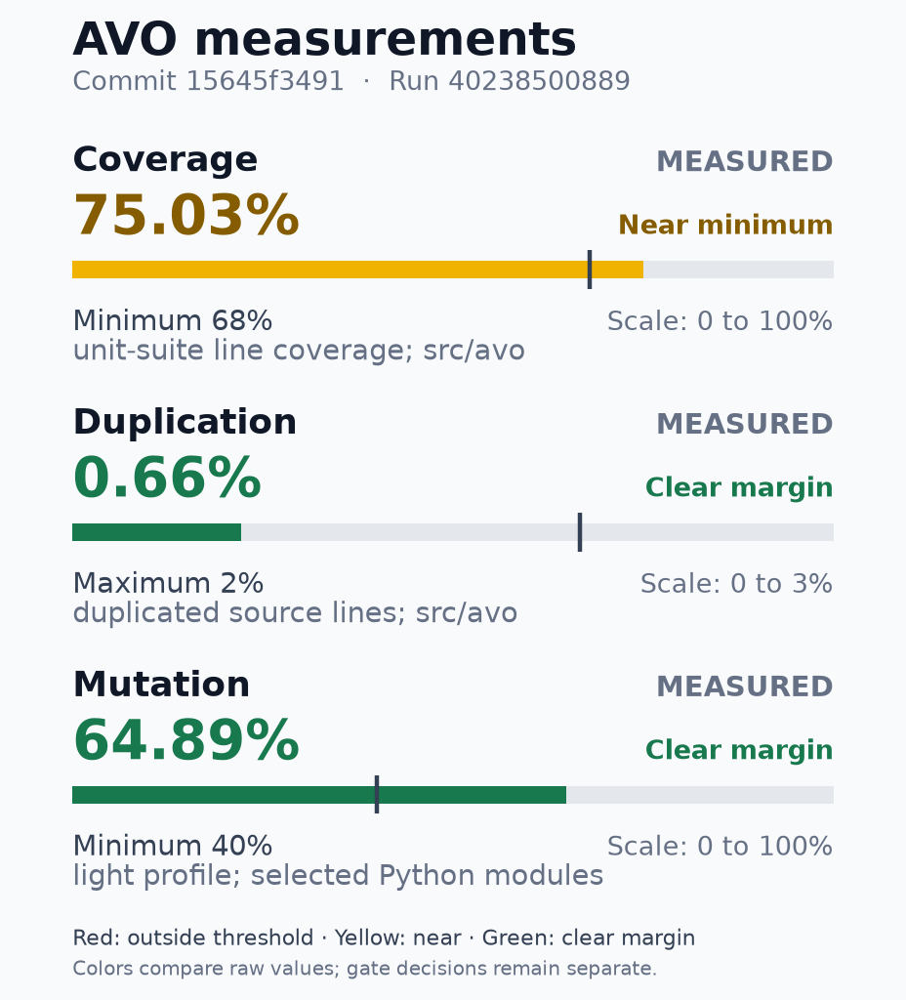

# Quality metrics

Release readout of the exact commit and CI run. Measurements and thresholds do not replace mandatory checks.

| Field | Value |
|---|---|
| Version | 1.18.0 |
| Tag | v1.18.0 |
| SHA | `15645f34911f0d6770a6b61768287342cd496522` |
| Recorded (UTC) | 2026-10-25T22:16:32Z |

## AVO quality

**Overall: PASS**

Commit: `15645f34911f0d6770a6b61768287342cd496522` · Run: `40238500889`

PR head: `Unavailable`
PR base: `Unavailable`
Tested revision: `15645f34911f0d6770a6b61768287342cd496522`
Attempt: 1. Passed producer evidence may come from earlier attempts of the same run.

All mandatory gate decisions and required jobs passed.

**Measurements**

Evidence completeness: 9 measured, 1 partial, 1 unavailable. Gate decisions are below.

Unavailable evidence: Safety branch coverage.

| Metric | Measured | Scope | Evidence |
|---|---|---|---|
| Line coverage | 75.03% | unit suite; src/avo | 23,397/31,182 executable lines [coverage.json](https://github.com/joaobispo2077/avo/actions/runs/40238500889/artifacts/12616531094) (SHA-256 `965a964adf83`) |
| Duplication | 0.66% | source lines; src/avo | 457/68,869 duplicated lines; 44 clone pairs [jscpd/jscpd-report.json](https://github.com/joaobispo2077/avo/actions/runs/40238500889/artifacts/12616531094) (SHA-256 `3b9ee04ec7b3`) |
| Mutation efficacy | 64.89% | light profile; selected Python modules | 207 killed / 112 survived / 319 total; 0 unresolved [mutation-metrics.json](https://github.com/joaobispo2077/avo/actions/runs/40238500889/artifacts/12616865198) (SHA-256 `844989da0937`) |

### Mutation efficacy by source

PARTIAL: Scope counters reconcile; some efficacy measurements are unavailable.
Existing mutation enforcement applies to the aggregate profile. Source colors and the aggregate floor line are informational comparisons.

Aggregate: 207 killed / 112 survived / 319 total; 0 unresolved. Complete execution: True.

Source excerpt: 5/5. Missing/incomplete first, then lowest measured efficacy; M IDs sort by full source path.

| Source ID and full path | Efficacy / state | Actual outcome counts |
|---|---|---|
| M005: [src/avo/validate_usability.py](https://github.com/joaobispo2077/avo/blob/15645f34911f0d6770a6b61768287342cd496522/src/avo/validate_usability.py) | Zero mutants; efficacy unavailable. | 0 killed / 0 survived / 0 total; 0 unresolved |
| M004: [src/avo/validate_dependencies.py](https://github.com/joaobispo2077/avo/blob/15645f34911f0d6770a6b61768287342cd496522/src/avo/validate_dependencies.py) | 52.13% | 110 killed / 101 survived / 211 total; 0 unresolved |
| M002: [src/avo/mcp/bridge.py](https://github.com/joaobispo2077/avo/blob/15645f34911f0d6770a6b61768287342cd496522/src/avo/mcp/bridge.py) | 87.18% | 68 killed / 10 survived / 78 total; 0 unresolved |
| M003: [src/avo/mcp/registry.py](https://github.com/joaobispo2077/avo/blob/15645f34911f0d6770a6b61768287342cd496522/src/avo/mcp/registry.py) | 95.65% | 22 killed / 1 survived / 23 total; 0 unresolved |
| M001: [src/avo/adapters/registry.py](https://github.com/joaobispo2077/avo/blob/15645f34911f0d6770a6b61768287342cd496522/src/avo/adapters/registry.py) | 100.00% | 7 killed / 0 survived / 7 total; 0 unresolved |

[Complete mutation source index and outcome proof (text archive)](kpi-detail:mutation-efficacy.md)

### Complexity and CRAP review

2831 observed functions; 2781 measured CRAP; 50 observed functions unmeasured; 0 source-analysis errors. Total population known.
CRAP reference 30 is informational. Existing complexity policy and exceptions remain separate.

**Cyclomatic complexity: 10/2831 eligible candidates shown**. highest observed values, capped at 10; ties: descending value, then canonical path, definition line, qualified name.

| ID | Full source identity | Observed value | Unit |
|---|---|---:|---|
| U0009 | [src/avo/adapters/media/audio_tracks.py:61 compile_continuous_audio_graph](https://github.com/joaobispo2077/avo/blob/15645f34911f0d6770a6b61768287342cd496522/src/avo/adapters/media/audio_tracks.py#L61) | 51 | independent paths |
| U2730 | [src/avo/validate_edl.py:110 _bluray_ps5_semantic_errors](https://github.com/joaobispo2077/avo/blob/15645f34911f0d6770a6b61768287342cd496522/src/avo/validate_edl.py#L110) | 49 | independent paths |
| U1102 | [src/avo/learndown_export.py:87 build_timeline_learning_snapshot](https://github.com/joaobispo2077/avo/blob/15645f34911f0d6770a6b61768287342cd496522/src/avo/learndown_export.py#L87) | 44 | independent paths |
| U2403 | [src/avo/timeline/proof_plan.py:407 ProofPlanCompiler.preflight](https://github.com/joaobispo2077/avo/blob/15645f34911f0d6770a6b61768287342cd496522/src/avo/timeline/proof_plan.py#L407) | 43 | independent paths |
| U2612 | [src/avo/timeline/vision_review.py:194 compile_review_coverage](https://github.com/joaobispo2077/avo/blob/15645f34911f0d6770a6b61768287342cd496522/src/avo/timeline/vision_review.py#L194) | 43 | independent paths |
| U2735 | [src/avo/validate_edl.py:289 _comparison_semantic_errors](https://github.com/joaobispo2077/avo/blob/15645f34911f0d6770a6b61768287342cd496522/src/avo/validate_edl.py#L289) | 42 | independent paths |
| U1891 | [src/avo/timeline/approval_service.py:1097 ApprovalService.decide](https://github.com/joaobispo2077/avo/blob/15645f34911f0d6770a6b61768287342cd496522/src/avo/timeline/approval_service.py#L1097) | 41 | independent paths |
| U2695 | [src/avo/update.py:282 run_update](https://github.com/joaobispo2077/avo/blob/15645f34911f0d6770a6b61768287342cd496522/src/avo/update.py#L282) | 40 | independent paths |
| U0623 | [src/avo/cli.py:1223 _review_batch](https://github.com/joaobispo2077/avo/blob/15645f34911f0d6770a6b61768287342cd496522/src/avo/cli.py#L1223) | 38 | independent paths |
| U2145 | [src/avo/timeline/iterations.py:255 IterationLedgerService.record_iteration](https://github.com/joaobispo2077/avo/blob/15645f34911f0d6770a6b61768287342cd496522/src/avo/timeline/iterations.py#L255) | 38 | independent paths |

**CRAP: 10/2781 eligible candidates shown**. highest observed values, capped at 10; ties: descending value, then canonical path, definition line, qualified name.

| ID | Full source identity | Observed value | Unit |
|---|---|---:|---|
| U2730 | [src/avo/validate_edl.py:110 _bluray_ps5_semantic_errors](https://github.com/joaobispo2077/avo/blob/15645f34911f0d6770a6b61768287342cd496522/src/avo/validate_edl.py#L110) | 2450 | CRAP score |
| U2735 | [src/avo/validate_edl.py:289 _comparison_semantic_errors](https://github.com/joaobispo2077/avo/blob/15645f34911f0d6770a6b61768287342cd496522/src/avo/validate_edl.py#L289) | 1806 | CRAP score |
| U0623 | [src/avo/cli.py:1223 _review_batch](https://github.com/joaobispo2077/avo/blob/15645f34911f0d6770a6b61768287342cd496522/src/avo/cli.py#L1223) | 1482 | CRAP score |
| U0361 | [src/avo/adapters/understand/watch_skill.py:1374 _native_review](https://github.com/joaobispo2077/avo/blob/15645f34911f0d6770a6b61768287342cd496522/src/avo/adapters/understand/watch_skill.py#L1374) | 870 | CRAP score |
| U2338 | [src/avo/timeline/pipeline.py:773 TimelinePipeline.advance](https://github.com/joaobispo2077/avo/blob/15645f34911f0d6770a6b61768287342cd496522/src/avo/timeline/pipeline.py#L773) | 735.738 | CRAP score |
| U1439 | [src/avo/render.py:1259 main](https://github.com/joaobispo2077/avo/blob/15645f34911f0d6770a6b61768287342cd496522/src/avo/render.py#L1259) | 663.228 | CRAP score |
| U0331 | [src/avo/adapters/understand/watch_skill.py:721 execute_bounded_passes](https://github.com/joaobispo2077/avo/blob/15645f34911f0d6770a6b61768287342cd496522/src/avo/adapters/understand/watch_skill.py#L721) | 600 | CRAP score |
| U0388 | [src/avo/audio_analysis.py:320 main](https://github.com/joaobispo2077/avo/blob/15645f34911f0d6770a6b61768287342cd496522/src/avo/audio_analysis.py#L320) | 600 | CRAP score |
| U2540 | [src/avo/timeline/stills.py:182 StillExtractionService.extract](https://github.com/joaobispo2077/avo/blob/15645f34911f0d6770a6b61768287342cd496522/src/avo/timeline/stills.py#L182) | 552 | CRAP score |
| U0598 | [src/avo/cli.py:550 _sync](https://github.com/joaobispo2077/avo/blob/15645f34911f0d6770a6b61768287342cd496522/src/avo/cli.py#L550) | 462 | CRAP score |

[Complete function index: hotspots.md (text archive)](kpi-detail:hotspots.md)

### File coupling: CE / CA

196 actual files at 71 positions; 575 distinct internal module edges; 1 namespace containers excluded from file points.
CE is horizontal (uses others); CA is vertical (used by others). Median references: CE 2, CA 2; all measured actual files including isolates, equality on the lower side. Spacing: piecewise log2(1 + count) around raw median; ticks show raw counts. Equal-area halves use independent scales around each median; equal areas do not mean equal numeric ranges. Regions describe connectivity, not architectural health or gate status.

Lookup excerpt: 19/71 coordinate groups; 80/196 files. Groups ordered by CE then CA; all members of each shown group are retained.

Indexed positions and files (bidirectional lookup)

| Position | CE | CA | Members | File ID and complete source identity |
|---|---:|---:|---:|---|
| G01 | 0 | 0 | 18 | F003: [src/avo/adapters/__init__.py](https://github.com/joaobispo2077/avo/blob/15645f34911f0d6770a6b61768287342cd496522/src/avo/adapters/__init__.py) |
| G01 | 0 | 0 | 18 | F005: [src/avo/adapters/media/__init__.py](https://github.com/joaobispo2077/avo/blob/15645f34911f0d6770a6b61768287342cd496522/src/avo/adapters/media/__init__.py) |
| G01 | 0 | 0 | 18 | F018: [src/avo/adapters/motion/__init__.py](https://github.com/joaobispo2077/avo/blob/15645f34911f0d6770a6b61768287342cd496522/src/avo/adapters/motion/__init__.py) |
| G01 | 0 | 0 | 18 | F020: [src/avo/adapters/qc/__init__.py](https://github.com/joaobispo2077/avo/blob/15645f34911f0d6770a6b61768287342cd496522/src/avo/adapters/qc/__init__.py) |
| G01 | 0 | 0 | 18 | F027: [src/avo/adapters/stubs/__init__.py](https://github.com/joaobispo2077/avo/blob/15645f34911f0d6770a6b61768287342cd496522/src/avo/adapters/stubs/__init__.py) |
| G01 | 0 | 0 | 18 | F033: [src/avo/adapters/transcribe/__init__.py](https://github.com/joaobispo2077/avo/blob/15645f34911f0d6770a6b61768287342cd496522/src/avo/adapters/transcribe/__init__.py) |
| G01 | 0 | 0 | 18 | F037: [src/avo/adapters/understand/__init__.py](https://github.com/joaobispo2077/avo/blob/15645f34911f0d6770a6b61768287342cd496522/src/avo/adapters/understand/__init__.py) |
| G01 | 0 | 0 | 18 | F039: [src/avo/adapters/understand/cutting_alignment_worker.py](https://github.com/joaobispo2077/avo/blob/15645f34911f0d6770a6b61768287342cd496522/src/avo/adapters/understand/cutting_alignment_worker.py) |
| G01 | 0 | 0 | 18 | F070: [src/avo/direction/__init__.py](https://github.com/joaobispo2077/avo/blob/15645f34911f0d6770a6b61768287342cd496522/src/avo/direction/__init__.py) |
| G01 | 0 | 0 | 18 | F080: [src/avo/engine_install.py](https://github.com/joaobispo2077/avo/blob/15645f34911f0d6770a6b61768287342cd496522/src/avo/engine_install.py) |
| G01 | 0 | 0 | 18 | F082: [src/avo/generate_sfx.py](https://github.com/joaobispo2077/avo/blob/15645f34911f0d6770a6b61768287342cd496522/src/avo/generate_sfx.py) |
| G01 | 0 | 0 | 18 | F102: [src/avo/pack_transcripts.py](https://github.com/joaobispo2077/avo/blob/15645f34911f0d6770a6b61768287342cd496522/src/avo/pack_transcripts.py) |
| G01 | 0 | 0 | 18 | F109: [src/avo/resources/directions/__init__.py](https://github.com/joaobispo2077/avo/blob/15645f34911f0d6770a6b61768287342cd496522/src/avo/resources/directions/__init__.py) |
| G01 | 0 | 0 | 18 | F127: [src/avo/srt_to_centered_ass.py](https://github.com/joaobispo2077/avo/blob/15645f34911f0d6770a6b61768287342cd496522/src/avo/srt_to_centered_ass.py) |
| G01 | 0 | 0 | 18 | F130: [src/avo/templates/__init__.py](https://github.com/joaobispo2077/avo/blob/15645f34911f0d6770a6b61768287342cd496522/src/avo/templates/__init__.py) |
| G01 | 0 | 0 | 18 | F131: [src/avo/templates/shorts_hyperframes/__init__.py](https://github.com/joaobispo2077/avo/blob/15645f34911f0d6770a6b61768287342cd496522/src/avo/templates/shorts_hyperframes/__init__.py) |
| G01 | 0 | 0 | 18 | F132: [src/avo/timeline/__init__.py](https://github.com/joaobispo2077/avo/blob/15645f34911f0d6770a6b61768287342cd496522/src/avo/timeline/__init__.py) |
| G01 | 0 | 0 | 18 | F167: [src/avo/timeline/models.py](https://github.com/joaobispo2077/avo/blob/15645f34911f0d6770a6b61768287342cd496522/src/avo/timeline/models.py) |
| G02 | 0 | 1 | 7 | F061: [src/avo/consume_mode.py](https://github.com/joaobispo2077/avo/blob/15645f34911f0d6770a6b61768287342cd496522/src/avo/consume_mode.py) |
| G02 | 0 | 1 | 7 | F083: [src/avo/grade.py](https://github.com/joaobispo2077/avo/blob/15645f34911f0d6770a6b61768287342cd496522/src/avo/grade.py) |
| G02 | 0 | 1 | 7 | F084: [src/avo/hardware.py](https://github.com/joaobispo2077/avo/blob/15645f34911f0d6770a6b61768287342cd496522/src/avo/hardware.py) |
| G02 | 0 | 1 | 7 | F094: [src/avo/mcp/request_state.py](https://github.com/joaobispo2077/avo/blob/15645f34911f0d6770a6b61768287342cd496522/src/avo/mcp/request_state.py) |
| G02 | 0 | 1 | 7 | F114: [src/avo/shorts_captions.py](https://github.com/joaobispo2077/avo/blob/15645f34911f0d6770a6b61768287342cd496522/src/avo/shorts_captions.py) |
| G02 | 0 | 1 | 7 | F148: [src/avo/timeline/cutting_previews.py](https://github.com/joaobispo2077/avo/blob/15645f34911f0d6770a6b61768287342cd496522/src/avo/timeline/cutting_previews.py) |
| G02 | 0 | 1 | 7 | F180: [src/avo/timeline/sync.py](https://github.com/joaobispo2077/avo/blob/15645f34911f0d6770a6b61768287342cd496522/src/avo/timeline/sync.py) |
| G03 | 0 | 2 | 6 | F058: [src/avo/build_captions.py](https://github.com/joaobispo2077/avo/blob/15645f34911f0d6770a6b61768287342cd496522/src/avo/build_captions.py) |
| G03 | 0 | 2 | 6 | F089: [src/avo/mcp/__init__.py](https://github.com/joaobispo2077/avo/blob/15645f34911f0d6770a6b61768287342cd496522/src/avo/mcp/__init__.py) |
| G03 | 0 | 2 | 6 | F138: [src/avo/timeline/command_registry.py](https://github.com/joaobispo2077/avo/blob/15645f34911f0d6770a6b61768287342cd496522/src/avo/timeline/command_registry.py) |
| G03 | 0 | 2 | 6 | F149: [src/avo/timeline/cutting_profiles.py](https://github.com/joaobispo2077/avo/blob/15645f34911f0d6770a6b61768287342cd496522/src/avo/timeline/cutting_profiles.py) |
| G03 | 0 | 2 | 6 | F156: [src/avo/timeline/diff.py](https://github.com/joaobispo2077/avo/blob/15645f34911f0d6770a6b61768287342cd496522/src/avo/timeline/diff.py) |
| G03 | 0 | 2 | 6 | F185: [src/avo/timeline_view.py](https://github.com/joaobispo2077/avo/blob/15645f34911f0d6770a6b61768287342cd496522/src/avo/timeline_view.py) |
| G04 | 0 | 3 | 3 | F133: [src/avo/timeline/animation.py](https://github.com/joaobispo2077/avo/blob/15645f34911f0d6770a6b61768287342cd496522/src/avo/timeline/animation.py) |
| G04 | 0 | 3 | 3 | F157: [src/avo/timeline/event_clock.py](https://github.com/joaobispo2077/avo/blob/15645f34911f0d6770a6b61768287342cd496522/src/avo/timeline/event_clock.py) |
| G04 | 0 | 3 | 3 | F163: [src/avo/timeline/mapping.py](https://github.com/joaobispo2077/avo/blob/15645f34911f0d6770a6b61768287342cd496522/src/avo/timeline/mapping.py) |
| G05 | 0 | 4 | 2 | F059: [src/avo/capabilities.py](https://github.com/joaobispo2077/avo/blob/15645f34911f0d6770a6b61768287342cd496522/src/avo/capabilities.py) |
| G05 | 0 | 4 | 2 | F112: [src/avo/settings.py](https://github.com/joaobispo2077/avo/blob/15645f34911f0d6770a6b61768287342cd496522/src/avo/settings.py) |
| G06 | 0 | 5 | 2 | F055: [src/avo/breath_control.py](https://github.com/joaobispo2077/avo/blob/15645f34911f0d6770a6b61768287342cd496522/src/avo/breath_control.py) |
| G06 | 0 | 5 | 2 | F125: [src/avo/shorts_rules.py](https://github.com/joaobispo2077/avo/blob/15645f34911f0d6770a6b61768287342cd496522/src/avo/shorts_rules.py) |
| G07 | 0 | 9 | 1 | F050: [src/avo/audio_restoration.py](https://github.com/joaobispo2077/avo/blob/15645f34911f0d6770a6b61768287342cd496522/src/avo/audio_restoration.py) |
| G08 | 0 | 11 | 1 | F170: [src/avo/timeline/ports.py](https://github.com/joaobispo2077/avo/blob/15645f34911f0d6770a6b61768287342cd496522/src/avo/timeline/ports.py) |
| G09 | 0 | 29 | 1 | F103: [src/avo/paths.py](https://github.com/joaobispo2077/avo/blob/15645f34911f0d6770a6b61768287342cd496522/src/avo/paths.py) |
| G10 | 1 | 0 | 13 | F001: [src/avo/__init__.py](https://github.com/joaobispo2077/avo/blob/15645f34911f0d6770a6b61768287342cd496522/src/avo/__init__.py) |
| G10 | 1 | 0 | 13 | F002: [src/avo/__main__.py](https://github.com/joaobispo2077/avo/blob/15645f34911f0d6770a6b61768287342cd496522/src/avo/__main__.py) |
| G10 | 1 | 0 | 13 | F017: [src/avo/adapters/media/waveform.py](https://github.com/joaobispo2077/avo/blob/15645f34911f0d6770a6b61768287342cd496522/src/avo/adapters/media/waveform.py) |
| G10 | 1 | 0 | 13 | F028: [src/avo/adapters/stubs/memory_ai_memory.py](https://github.com/joaobispo2077/avo/blob/15645f34911f0d6770a6b61768287342cd496522/src/avo/adapters/stubs/memory_ai_memory.py) |
| G10 | 1 | 0 | 13 | F029: [src/avo/adapters/stubs/motion_hyperframes.py](https://github.com/joaobispo2077/avo/blob/15645f34911f0d6770a6b61768287342cd496522/src/avo/adapters/stubs/motion_hyperframes.py) |
| G10 | 1 | 0 | 13 | F030: [src/avo/adapters/stubs/motion_remotion.py](https://github.com/joaobispo2077/avo/blob/15645f34911f0d6770a6b61768287342cd496522/src/avo/adapters/stubs/motion_remotion.py) |
| G10 | 1 | 0 | 13 | F031: [src/avo/adapters/stubs/plan_speckit.py](https://github.com/joaobispo2077/avo/blob/15645f34911f0d6770a6b61768287342cd496522/src/avo/adapters/stubs/plan_speckit.py) |
| G10 | 1 | 0 | 13 | F090: [src/avo/mcp/__main__.py](https://github.com/joaobispo2077/avo/blob/15645f34911f0d6770a6b61768287342cd496522/src/avo/mcp/__main__.py) |
| G10 | 1 | 0 | 13 | F104: [src/avo/prepare_transcription.py](https://github.com/joaobispo2077/avo/blob/15645f34911f0d6770a6b61768287342cd496522/src/avo/prepare_transcription.py) |
| G10 | 1 | 0 | 13 | F146: [src/avo/timeline/cutting_evaluation.py](https://github.com/joaobispo2077/avo/blob/15645f34911f0d6770a6b61768287342cd496522/src/avo/timeline/cutting_evaluation.py) |
| G10 | 1 | 0 | 13 | F187: [src/avo/transcribe_batch.py](https://github.com/joaobispo2077/avo/blob/15645f34911f0d6770a6b61768287342cd496522/src/avo/transcribe_batch.py) |
| G10 | 1 | 0 | 13 | F189: [src/avo/validate_dependencies.py](https://github.com/joaobispo2077/avo/blob/15645f34911f0d6770a6b61768287342cd496522/src/avo/validate_dependencies.py) |
| G10 | 1 | 0 | 13 | F191: [src/avo/validate_usability.py](https://github.com/joaobispo2077/avo/blob/15645f34911f0d6770a6b61768287342cd496522/src/avo/validate_usability.py) |
| G11 | 1 | 1 | 9 | F014: [src/avo/adapters/media/sync_materializer.py](https://github.com/joaobispo2077/avo/blob/15645f34911f0d6770a6b61768287342cd496522/src/avo/adapters/media/sync_materializer.py) |
| G11 | 1 | 1 | 9 | F016: [src/avo/adapters/media/video_tracks.py](https://github.com/joaobispo2077/avo/blob/15645f34911f0d6770a6b61768287342cd496522/src/avo/adapters/media/video_tracks.py) |
| G11 | 1 | 1 | 9 | F041: [src/avo/adapters/understand/cutting_semantics.py](https://github.com/joaobispo2077/avo/blob/15645f34911f0d6770a6b61768287342cd496522/src/avo/adapters/understand/cutting_semantics.py) |
| G11 | 1 | 1 | 9 | F054: [src/avo/breath_analysis.py](https://github.com/joaobispo2077/avo/blob/15645f34911f0d6770a6b61768287342cd496522/src/avo/breath_analysis.py) |
| G11 | 1 | 1 | 9 | F078: [src/avo/edl_timeline.py](https://github.com/joaobispo2077/avo/blob/15645f34911f0d6770a6b61768287342cd496522/src/avo/edl_timeline.py) |
| G11 | 1 | 1 | 9 | F079: [src/avo/engine_cli.py](https://github.com/joaobispo2077/avo/blob/15645f34911f0d6770a6b61768287342cd496522/src/avo/engine_cli.py) |
| G11 | 1 | 1 | 9 | F091: [src/avo/mcp/bridge.py](https://github.com/joaobispo2077/avo/blob/15645f34911f0d6770a6b61768287342cd496522/src/avo/mcp/bridge.py) |
| G11 | 1 | 1 | 9 | F092: [src/avo/mcp/mrtr.py](https://github.com/joaobispo2077/avo/blob/15645f34911f0d6770a6b61768287342cd496522/src/avo/mcp/mrtr.py) |
| G11 | 1 | 1 | 9 | F183: [src/avo/timeline/vision_review.py](https://github.com/joaobispo2077/avo/blob/15645f34911f0d6770a6b61768287342cd496522/src/avo/timeline/vision_review.py) |
| G12 | 1 | 2 | 8 | F024: [src/avo/adapters/qc/source_fidelity.py](https://github.com/joaobispo2077/avo/blob/15645f34911f0d6770a6b61768287342cd496522/src/avo/adapters/qc/source_fidelity.py) |
| G12 | 1 | 2 | 8 | F043: [src/avo/adapters/understand/watch_policy.py](https://github.com/joaobispo2077/avo/blob/15645f34911f0d6770a6b61768287342cd496522/src/avo/adapters/understand/watch_policy.py) |
| G12 | 1 | 2 | 8 | F047: [src/avo/audio_eq.py](https://github.com/joaobispo2077/avo/blob/15645f34911f0d6770a6b61768287342cd496522/src/avo/audio_eq.py) |
| G12 | 1 | 2 | 8 | F069: [src/avo/delivery_fidelity.py](https://github.com/joaobispo2077/avo/blob/15645f34911f0d6770a6b61768287342cd496522/src/avo/delivery_fidelity.py) |
| G12 | 1 | 2 | 8 | F110: [src/avo/scratch.py](https://github.com/joaobispo2077/avo/blob/15645f34911f0d6770a6b61768287342cd496522/src/avo/scratch.py) |
| G12 | 1 | 2 | 8 | F120: [src/avo/shorts_paths.py](https://github.com/joaobispo2077/avo/blob/15645f34911f0d6770a6b61768287342cd496522/src/avo/shorts_paths.py) |
| G12 | 1 | 2 | 8 | F126: [src/avo/shorts_visuals.py](https://github.com/joaobispo2077/avo/blob/15645f34911f0d6770a6b61768287342cd496522/src/avo/shorts_visuals.py) |
| G12 | 1 | 2 | 8 | F165: [src/avo/timeline/media_admission.py](https://github.com/joaobispo2077/avo/blob/15645f34911f0d6770a6b61768287342cd496522/src/avo/timeline/media_admission.py) |
| G13 | 1 | 3 | 2 | F088: [src/avo/master_artifacts.py](https://github.com/joaobispo2077/avo/blob/15645f34911f0d6770a6b61768287342cd496522/src/avo/master_artifacts.py) |
| G13 | 1 | 3 | 2 | F093: [src/avo/mcp/registry.py](https://github.com/joaobispo2077/avo/blob/15645f34911f0d6770a6b61768287342cd496522/src/avo/mcp/registry.py) |
| G14 | 1 | 4 | 2 | F011: [src/avo/adapters/media/ffprobe.py](https://github.com/joaobispo2077/avo/blob/15645f34911f0d6770a6b61768287342cd496522/src/avo/adapters/media/ffprobe.py) |
| G14 | 1 | 4 | 2 | F065: [src/avo/cost_sources.py](https://github.com/joaobispo2077/avo/blob/15645f34911f0d6770a6b61768287342cd496522/src/avo/cost_sources.py) |
| G15 | 1 | 5 | 1 | F087: [src/avo/loudness_profiles.py](https://github.com/joaobispo2077/avo/blob/15645f34911f0d6770a6b61768287342cd496522/src/avo/loudness_profiles.py) |
| G16 | 1 | 6 | 1 | F067: [src/avo/costs.py](https://github.com/joaobispo2077/avo/blob/15645f34911f0d6770a6b61768287342cd496522/src/avo/costs.py) |
| G17 | 1 | 7 | 1 | F072: [src/avo/direction/rules.py](https://github.com/joaobispo2077/avo/blob/15645f34911f0d6770a6b61768287342cd496522/src/avo/direction/rules.py) |
| G18 | 1 | 10 | 1 | F115: [src/avo/shorts_contract.py](https://github.com/joaobispo2077/avo/blob/15645f34911f0d6770a6b61768287342cd496522/src/avo/shorts_contract.py) |
| G19 | 1 | 14 | 1 | F144: [src/avo/timeline/cutting_contracts.py](https://github.com/joaobispo2077/avo/blob/15645f34911f0d6770a6b61768287342cd496522/src/avo/timeline/cutting_contracts.py) |

[Complete bidirectional file index: coupling-index.md (text archive)](kpi-detail:coupling-index.md)

**Findings and accepted debt**

- Dependency findings: PASS, 0 critical, 4 high, 3 moderate, 0 low: zod@3.25.76 GHSA-mrhx-c7xc-m3w5, sharp@0.35.4 GHSA-wq5f-xc86-pv6w, source-map-js@1.2.1 GHSA-68fv-2mgg-jv7q, undici@7.30.0 GHSA-4qv8-2p9j-2685 (MEASURED). [npm-audit-summary.json](https://github.com/joaobispo2077/avo/actions/runs/40238500889/artifacts/12616531094) (SHA-256 `c9f4766e39fb`); [deps-findings.json](https://github.com/joaobispo2077/avo/actions/runs/40238500889/artifacts/12616531094) (SHA-256 `c4769a32b091`); [pip-audit-raw.json](https://github.com/joaobispo2077/avo/actions/runs/40238500889/artifacts/12616531094) (SHA-256 `e7548ec51f3c`); [npm-audit-raw.json](https://github.com/joaobispo2077/avo/actions/runs/40238500889/artifacts/12616531094) (SHA-256 `6dff9ba0cabc`)
- Dead-code findings: 149 reported; 0 unwaived (MEASURED). [deadcode.json](https://github.com/joaobispo2077/avo/actions/runs/40238500889/artifacts/12616531094) (SHA-256 `108bc58a34b0`)
- Import boundaries: 6 kept; 0 broken (MEASURED). [gates/architecture/gate.json](https://github.com/joaobispo2077/avo/actions/runs/40238500889/artifacts/12616531094) (SHA-256 `083e2727b57e`); [gates/architecture/gate.log](https://github.com/joaobispo2077/avo/actions/runs/40238500889/artifacts/12616531094) (SHA-256 `54aa8532054d`)
- Dependency hoist plan: 24 proposed package changes (MEASURED). [dependency-tree.json](https://github.com/joaobispo2077/avo/actions/runs/40238500889/artifacts/12616531094) (SHA-256 `789b68dd7822`)
- complexity: 173 configured entries; 173 matched findings; 173 unique affected path/name identities; stale: 0; 0 unwaived findings. Groups are non-additive; these counts are not defect removal.
- deadcode: 149 configured entries; 149 matched findings; 149 unique affected path/name identities; stale: 0; 0 unwaived findings. Groups are non-additive; these counts are not defect removal.

**Executed test evidence**

- repo-integration-tests: 129 passed / 0 failed / 0 errors / 1 skipped; 130 testcase events. MEASURED. Repeated events are not additional unique tests.
- repo-unit-tests: 3427 passed / 0 failed / 0 errors / 7 skipped; 3434 testcase events. MEASURED. Repeated events are not additional unique tests.

**Gate decisions**

Status badges are categorical. Missing execution proof cannot certify a recorded PASS; recorded results stay labeled separately. Required jobs are listed separately below.

[Complete gate decisions and proof (text archive)](kpi-detail:gate-decisions.md)

| Gate | Decision | Policy | Execution evidence |
|---|---|---|---|
| Lint | **PASS** | Ruff (&#96;src/avo&#96;, &#96;tests&#96;, &#96;helpers&#96;) + ESLint | Captured exit 0. Numeric finding count not exported.. [gates/lint/gate.json](https://github.com/joaobispo2077/avo/actions/runs/40238500889/artifacts/12616531094) (SHA-256 `56953be54358`); [gates/lint/gate.log](https://github.com/joaobispo2077/avo/actions/runs/40238500889/artifacts/12616531094) (SHA-256 `1237e674bddf`) |
| Format | **PASS** | Ruff format --check + Prettier --check | Captured exit 0. Numeric finding count not exported.. [gates/format/gate.json](https://github.com/joaobispo2077/avo/actions/runs/40238500889/artifacts/12616531094) (SHA-256 `c9039e5f038d`); [gates/format/gate.log](https://github.com/joaobispo2077/avo/actions/runs/40238500889/artifacts/12616531094) (SHA-256 `572693e7fdce`) |
| Coverage | **PASS** | pytest-cov fail-under on &#96;src/avo&#96;; Minimum 68%; comparison rounded to 0 decimal places | 75.03% · 23,397/31,182 executable lines. [gates/coverage/gate.json](https://github.com/joaobispo2077/avo/actions/runs/40238500889/artifacts/12616531094) (SHA-256 `362f047f19f1`); [gates/coverage/gate.log](https://github.com/joaobispo2077/avo/actions/runs/40238500889/artifacts/12616531094) (SHA-256 `b966de18b009`) |
| Complexity | **PASS** | xenon max-absolute **B** · Ruff C901 ≤ 31 | 0 unwaived · 173 observed accepted findings. [gates/complexity/gate.json](https://github.com/joaobispo2077/avo/actions/runs/40238500889/artifacts/12616531094) (SHA-256 `741f53889987`); [gates/complexity/gate.log](https://github.com/joaobispo2077/avo/actions/runs/40238500889/artifacts/12616531094) (SHA-256 `2afa7c325606`) |
| Dependency audit | **PASS · yellow** | pip-audit on dev + MCP; unwaived Python advisories and npm critical block (&#96;deps-audit-allowlist.json&#96;); high or moderate is a yellow PASS, low-only or clean is a green PASS; the metric names each high package | PASS, 0 critical, 4 high, 3 moderate, 0 low: zod@3.25.76 GHSA-mrhx-c7xc-m3w5, sharp@0.35.4 GHSA-wq5f-xc86-pv6w, source-map-js@1.2.1 GHSA-68fv-2mgg-jv7q, undici@7.30.0 GHSA-4qv8-2p9j-2685. [gates/deps/gate.json](https://github.com/joaobispo2077/avo/actions/runs/40238500889/artifacts/12616531094) (SHA-256 `bef98ff5e748`); [gates/deps/gate.log](https://github.com/joaobispo2077/avo/actions/runs/40238500889/artifacts/12616531094) (SHA-256 `2385cda00b73`) |
| Dead code | **PASS** | vulture confidence ≥ 60 (&#96;deadcode-allowlist.json&#96;) | 149 reported; 0 unwaived. [gates/deadcode/gate.json](https://github.com/joaobispo2077/avo/actions/runs/40238500889/artifacts/12616531094) (SHA-256 `c43695bdb5c5`); [gates/deadcode/gate.log](https://github.com/joaobispo2077/avo/actions/runs/40238500889/artifacts/12616531094) (SHA-256 `e284088d452a`) |
| Duplication | **PASS** | jscpd on &#96;src/avo&#96;; Maximum 2% | 0.66% · 457/68,869 duplicated lines; 44 clone pairs. [gates/duplication/gate.json](https://github.com/joaobispo2077/avo/actions/runs/40238500889/artifacts/12616531094) (SHA-256 `4d6c69da893a`); [gates/duplication/gate.log](https://github.com/joaobispo2077/avo/actions/runs/40238500889/artifacts/12616531094) (SHA-256 `f8a00efba1f6`) |
| Architecture | **PASS** | import-linter (&#96;.importlinter&#96;) | 6 kept; 0 broken. [gates/architecture/gate.json](https://github.com/joaobispo2077/avo/actions/runs/40238500889/artifacts/12616531094) (SHA-256 `083e2727b57e`); [gates/architecture/gate.log](https://github.com/joaobispo2077/avo/actions/runs/40238500889/artifacts/12616531094) (SHA-256 `54aa8532054d`) |
| Dependency tree | **PASS** | npm find-dupes · command fail blocks · hoist plan report-only | 24 proposed package changes · 1 additions / 6 removals / 17 changes; not applied. [gates/tree/gate.json](https://github.com/joaobispo2077/avo/actions/runs/40238500889/artifacts/12616531094) (SHA-256 `6a98634bd1e6`); [gates/tree/gate.log](https://github.com/joaobispo2077/avo/actions/runs/40238500889/artifacts/12616531094) (SHA-256 `3f5118753965`) |
| Mutation | **PASS** | Complete accounting; Minimum 40%; light profile; selected Python modules | [mutation-metrics.json](https://github.com/joaobispo2077/avo/actions/runs/40238500889/artifacts/12616865198) (SHA-256 `844989da0937`) |

Execution results

| Required job | Result | Test evidence |
|---|---|---|
| ci-readiness | **SUCCESS** | Job result; testcase counts not captured. Not captured |
| mutation-light | **SUCCESS** | Job result; testcase counts not captured. Not captured |
| prerequisites-gate | **SUCCESS** | Job result; testcase counts not captured. Not captured |
| repo-integration-tests | **SUCCESS** | 129 passed / 0 failed / 0 errors / 1 skipped; 130 JUnit testcases. MEASURED: Counts from actual native JUnit testcase events. [integration-tests.xml](https://github.com/joaobispo2077/avo/actions/runs/40238500889/artifacts/12615479875) (SHA-256 `671c42658620`); [gates/integration-tests/gate.log](https://github.com/joaobispo2077/avo/actions/runs/40238500889/artifacts/12615479875) (SHA-256 `d1bfa92c4066`) |
| repo-unit-tests | **SUCCESS** | 3427 passed / 0 failed / 0 errors / 7 skipped; 3434 JUnit testcases. MEASURED: Counts from actual native JUnit testcase events. [unit-tests.xml](https://github.com/joaobispo2077/avo/actions/runs/40238500889/artifacts/12616495819) (SHA-256 `75fc7a810292`); [gates/unit-tests/gate.log](https://github.com/joaobispo2077/avo/actions/runs/40238500889/artifacts/12616495819) (SHA-256 `fb2e6d4a258e`) |
| software-quality | **SUCCESS** | Job result; testcase counts not captured. Not captured |
| usability-gate | **SUCCESS** | Job result; testcase counts not captured. Not captured |

Recorded skip/failure reasons: 1/1 non-passing testcase events shown; complete events and full reasons remain in the raw JUnit evidence.

| Suite / case | Outcome | Recorded reason |
|---|---|---|
| pytest:tests.integration.test_watch_adapter_runtime:test_bundled_watch_skill_executable_contract | skipped | watch-skill is not installed under tools/watch-skill /home/runner/work/avo/avo/tests/integration/test_watch_adapter_runtime.py:12: watch-skill is not installed under tools/watch-skill |

Recorded skip/failure reasons: 7/7 non-passing testcase events shown; complete events and full reasons remain in the raw JUnit evidence.

| Suite / case | Outcome | Recorded reason |
|---|---|---|
| pytest:tests.test_master_artifacts:test_legacy_windows_stem_matching_remains_case_insensitive | skipped | legacy Windows glob is case-insensitive /home/runner/work/avo/avo/tests/test_master_artifacts.py:80: legacy Windows glob is case-insensitive |
| pytest:tests.test_mcp_bridge:test_register_cli_tools_on_server | skipped | could not import 'mcp': No module named 'mcp' /home/runner/work/avo/avo/tests/test_mcp_bridge.py:376: could not import 'mcp': No module named 'mcp' |
| pytest:tests.test_mcp_meta:test_registered_meta_tools_on_server | skipped | could not import 'mcp': No module named 'mcp' /home/runner/work/avo/avo/tests/test_mcp_meta.py:102: could not import 'mcp': No module named 'mcp' |
| pytest:tests.test_mcp_package:test_create_server_registers_meta_and_all_cli_tools | skipped | could not import 'mcp': No module named 'mcp' /home/runner/work/avo/avo/tests/test_mcp_package.py:70: could not import 'mcp': No module named 'mcp' |
| pytest:tests.test_software_foundation.SoftwareFoundationTests:test_claude_foundation_skills_exist | skipped | .cursor/.claude dev tooling is gitignored in public checkouts /home/runner/work/avo/avo/tests/test_software_foundation.py:65: .cursor/.claude dev tooling is gitignored in public checkouts |
| pytest:tests.test_software_foundation.SoftwareFoundationTests:test_cursor_foundation_rules_exist | skipped | .cursor/.claude dev tooling is gitignored in public checkouts /home/runner/work/avo/avo/tests/test_software_foundation.py:44: .cursor/.claude dev tooling is gitignored in public checkouts |
| pytest:tests.test_software_foundation.SoftwareFoundationTests:test_cursor_skills_mirrored | skipped | .cursor/.claude dev tooling is gitignored in public checkouts /home/runner/work/avo/avo/tests/test_software_foundation.py:73: .cursor/.claude dev tooling is gitignored in public checkouts |

Successful execution is not a measured quality score. Uncaptured counts remain unavailable.

[Run logs and downloadable artifacts](https://github.com/joaobispo2077/avo/actions/runs/40238500889)

Diagnostic excerpt omitted for publication size. Complete observations and reasons remain in normalized JSON and linked text artifacts.

