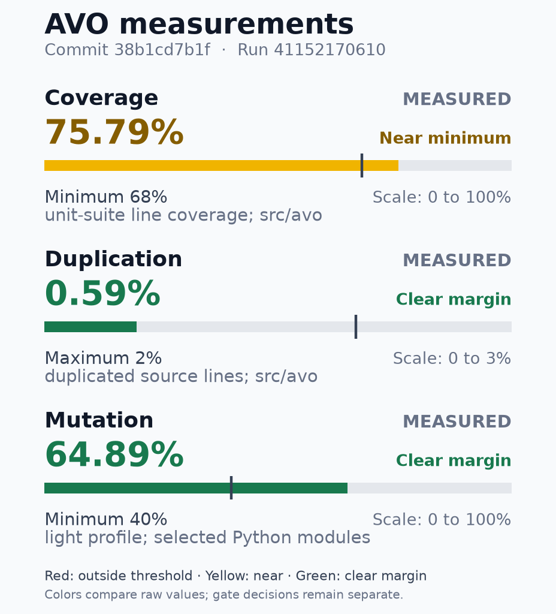

# Quality metrics

Release readout of the exact commit and CI run. Measurements and thresholds do not replace mandatory checks.

| Field | Value |
|---|---|
| Version | 1.19.0 |
| Tag | v1.19.0 |
| SHA | `38b1cd7b1f36d18c9e2d4f289ba947a30e2960f4` |
| Recorded (UTC) | 2026-10-31T01:06:16Z |

## AVO quality

**Overall: PASS**

Commit: `38b1cd7b1f36d18c9e2d4f289ba947a30e2960f4` · Run: `41152170610`

PR head: `Unavailable`
PR base: `Unavailable`
Tested revision: `38b1cd7b1f36d18c9e2d4f289ba947a30e2960f4`
Attempt: 2. Passed producer evidence may come from earlier attempts of the same run.

All mandatory gate decisions and required jobs passed.

**Measurements**

Evidence completeness: 9 measured, 1 partial, 1 unavailable. Gate decisions are below.

Unavailable evidence: Safety branch coverage.

| Metric | Measured | Scope | Evidence |
|---|---|---|---|
| Line coverage | 75.79% | unit suite; src/avo | 28,369/37,430 executable lines [coverage.json](https://github.com/joaobispo2077/avo/actions/runs/41152170610/artifacts/13023818928) (SHA-256 `d22ba0e5ee98`) |
| Duplication | 0.59% | source lines; src/avo | 487/82,202 duplicated lines; 47 clone pairs [jscpd/jscpd-report.json](https://github.com/joaobispo2077/avo/actions/runs/41152170610/artifacts/13023818928) (SHA-256 `6f074c876ee7`) |
| Mutation efficacy | 64.89% | light profile; selected Python modules | 207 killed / 112 survived / 319 total; 0 unresolved [mutation-metrics.json](https://github.com/joaobispo2077/avo/actions/runs/41152170610/artifacts/13024460109) (SHA-256 `55d0734d83c1`) |

### Mutation efficacy by source

PARTIAL: Scope counters reconcile; some efficacy measurements are unavailable.
Existing mutation enforcement applies to the aggregate profile. Source colors and the aggregate floor line are informational comparisons.

Aggregate: 207 killed / 112 survived / 319 total; 0 unresolved. Complete execution: True.

Source excerpt: 5/5. Missing/incomplete first, then lowest measured efficacy; M IDs sort by full source path.

| Source ID and full path | Efficacy / state | Actual outcome counts |
|---|---|---|
| M005: [src/avo/validate_usability.py](https://github.com/joaobispo2077/avo/blob/38b1cd7b1f36d18c9e2d4f289ba947a30e2960f4/src/avo/validate_usability.py) | Zero mutants; efficacy unavailable. | 0 killed / 0 survived / 0 total; 0 unresolved |
| M004: [src/avo/validate_dependencies.py](https://github.com/joaobispo2077/avo/blob/38b1cd7b1f36d18c9e2d4f289ba947a30e2960f4/src/avo/validate_dependencies.py) | 52.13% | 110 killed / 101 survived / 211 total; 0 unresolved |
| M002: [src/avo/mcp/bridge.py](https://github.com/joaobispo2077/avo/blob/38b1cd7b1f36d18c9e2d4f289ba947a30e2960f4/src/avo/mcp/bridge.py) | 87.18% | 68 killed / 10 survived / 78 total; 0 unresolved |
| M003: [src/avo/mcp/registry.py](https://github.com/joaobispo2077/avo/blob/38b1cd7b1f36d18c9e2d4f289ba947a30e2960f4/src/avo/mcp/registry.py) | 95.65% | 22 killed / 1 survived / 23 total; 0 unresolved |
| M001: [src/avo/adapters/registry.py](https://github.com/joaobispo2077/avo/blob/38b1cd7b1f36d18c9e2d4f289ba947a30e2960f4/src/avo/adapters/registry.py) | 100.00% | 7 killed / 0 survived / 7 total; 0 unresolved |

[Complete mutation source index and outcome proof (text archive)](kpi-detail:mutation-efficacy.md)

### Complexity and CRAP review

3418 observed functions; 3368 measured CRAP; 50 observed functions unmeasured; 0 source-analysis errors. Total population known.
CRAP reference 30 is informational. Existing complexity policy and exceptions remain separate.

**Cyclomatic complexity: 10/3418 eligible candidates shown**. highest observed values, capped at 10; ties: descending value, then canonical path, definition line, qualified name.

| ID | Full source identity | Observed value | Unit |
|---|---|---:|---|
| U0009 | [src/avo/adapters/media/audio_tracks.py:61 compile_continuous_audio_graph](https://github.com/joaobispo2077/avo/blob/38b1cd7b1f36d18c9e2d4f289ba947a30e2960f4/src/avo/adapters/media/audio_tracks.py#L61) | 51 | independent paths |
| U3315 | [src/avo/validate_edl.py:110 _bluray_ps5_semantic_errors](https://github.com/joaobispo2077/avo/blob/38b1cd7b1f36d18c9e2d4f289ba947a30e2960f4/src/avo/validate_edl.py#L110) | 49 | independent paths |
| U1276 | [src/avo/learndown_export.py:87 build_timeline_learning_snapshot](https://github.com/joaobispo2077/avo/blob/38b1cd7b1f36d18c9e2d4f289ba947a30e2960f4/src/avo/learndown_export.py#L87) | 44 | independent paths |
| U2946 | [src/avo/timeline/proof_plan.py:541 ProofPlanCompiler.preflight](https://github.com/joaobispo2077/avo/blob/38b1cd7b1f36d18c9e2d4f289ba947a30e2960f4/src/avo/timeline/proof_plan.py#L541) | 43 | independent paths |
| U3189 | [src/avo/timeline/vision_review.py:194 compile_review_coverage](https://github.com/joaobispo2077/avo/blob/38b1cd7b1f36d18c9e2d4f289ba947a30e2960f4/src/avo/timeline/vision_review.py#L194) | 43 | independent paths |
| U3320 | [src/avo/validate_edl.py:289 _comparison_semantic_errors](https://github.com/joaobispo2077/avo/blob/38b1cd7b1f36d18c9e2d4f289ba947a30e2960f4/src/avo/validate_edl.py#L289) | 42 | independent paths |
| U2381 | [src/avo/timeline/approval_service.py:1196 ApprovalService.decide](https://github.com/joaobispo2077/avo/blob/38b1cd7b1f36d18c9e2d4f289ba947a30e2960f4/src/avo/timeline/approval_service.py#L1196) | 41 | independent paths |
| U3276 | [src/avo/update.py:282 run_update](https://github.com/joaobispo2077/avo/blob/38b1cd7b1f36d18c9e2d4f289ba947a30e2960f4/src/avo/update.py#L282) | 40 | independent paths |
| U0797 | [src/avo/cli.py:1706 _review_batch](https://github.com/joaobispo2077/avo/blob/38b1cd7b1f36d18c9e2d4f289ba947a30e2960f4/src/avo/cli.py#L1706) | 38 | independent paths |
| U2660 | [src/avo/timeline/iterations.py:255 IterationLedgerService.record_iteration](https://github.com/joaobispo2077/avo/blob/38b1cd7b1f36d18c9e2d4f289ba947a30e2960f4/src/avo/timeline/iterations.py#L255) | 38 | independent paths |

**CRAP: 10/3368 eligible candidates shown**. highest observed values, capped at 10; ties: descending value, then canonical path, definition line, qualified name.

| ID | Full source identity | Observed value | Unit |
|---|---|---:|---|
| U3315 | [src/avo/validate_edl.py:110 _bluray_ps5_semantic_errors](https://github.com/joaobispo2077/avo/blob/38b1cd7b1f36d18c9e2d4f289ba947a30e2960f4/src/avo/validate_edl.py#L110) | 2450 | CRAP score |
| U3320 | [src/avo/validate_edl.py:289 _comparison_semantic_errors](https://github.com/joaobispo2077/avo/blob/38b1cd7b1f36d18c9e2d4f289ba947a30e2960f4/src/avo/validate_edl.py#L289) | 1806 | CRAP score |
| U0797 | [src/avo/cli.py:1706 _review_batch](https://github.com/joaobispo2077/avo/blob/38b1cd7b1f36d18c9e2d4f289ba947a30e2960f4/src/avo/cli.py#L1706) | 1482 | CRAP score |
| U0515 | [src/avo/adapters/understand/watch_skill.py:1374 _native_review](https://github.com/joaobispo2077/avo/blob/38b1cd7b1f36d18c9e2d4f289ba947a30e2960f4/src/avo/adapters/understand/watch_skill.py#L1374) | 870 | CRAP score |
| U2873 | [src/avo/timeline/pipeline.py:791 TimelinePipeline.advance](https://github.com/joaobispo2077/avo/blob/38b1cd7b1f36d18c9e2d4f289ba947a30e2960f4/src/avo/timeline/pipeline.py#L791) | 735.738 | CRAP score |
| U1895 | [src/avo/render.py:1259 main](https://github.com/joaobispo2077/avo/blob/38b1cd7b1f36d18c9e2d4f289ba947a30e2960f4/src/avo/render.py#L1259) | 663.228 | CRAP score |
| U0485 | [src/avo/adapters/understand/watch_skill.py:721 execute_bounded_passes](https://github.com/joaobispo2077/avo/blob/38b1cd7b1f36d18c9e2d4f289ba947a30e2960f4/src/avo/adapters/understand/watch_skill.py#L721) | 600 | CRAP score |
| U0542 | [src/avo/audio_analysis.py:320 main](https://github.com/joaobispo2077/avo/blob/38b1cd7b1f36d18c9e2d4f289ba947a30e2960f4/src/avo/audio_analysis.py#L320) | 600 | CRAP score |
| U3113 | [src/avo/timeline/stills.py:182 StillExtractionService.extract](https://github.com/joaobispo2077/avo/blob/38b1cd7b1f36d18c9e2d4f289ba947a30e2960f4/src/avo/timeline/stills.py#L182) | 552 | CRAP score |
| U0759 | [src/avo/cli.py:610 _sync](https://github.com/joaobispo2077/avo/blob/38b1cd7b1f36d18c9e2d4f289ba947a30e2960f4/src/avo/cli.py#L610) | 462 | CRAP score |

[Complete function index: hotspots.md (text archive)](kpi-detail:hotspots.md)

### File coupling: CE / CA

225 actual files at 79 positions; 713 distinct internal module edges; 1 namespace containers excluded from file points.
CE is horizontal (uses others); CA is vertical (used by others). Median references: CE 2, CA 2; all measured actual files including isolates, equality on the lower side. Spacing: piecewise log2(1 + count) around raw median; ticks show raw counts. Equal-area halves use independent scales around each median; equal areas do not mean equal numeric ranges. Regions describe connectivity, not architectural health or gate status.

Lookup excerpt: 13/79 coordinate groups; 80/225 files. Groups ordered by CE then CA; all members of each shown group are retained.

Indexed positions and files (bidirectional lookup)

| Position | CE | CA | Members | File ID and complete source identity |
|---|---:|---:|---:|---|
| G01 | 0 | 0 | 20 | F003: [src/avo/adapters/__init__.py](https://github.com/joaobispo2077/avo/blob/38b1cd7b1f36d18c9e2d4f289ba947a30e2960f4/src/avo/adapters/__init__.py) |
| G01 | 0 | 0 | 20 | F005: [src/avo/adapters/media/__init__.py](https://github.com/joaobispo2077/avo/blob/38b1cd7b1f36d18c9e2d4f289ba947a30e2960f4/src/avo/adapters/media/__init__.py) |
| G01 | 0 | 0 | 20 | F023: [src/avo/adapters/motion/__init__.py](https://github.com/joaobispo2077/avo/blob/38b1cd7b1f36d18c9e2d4f289ba947a30e2960f4/src/avo/adapters/motion/__init__.py) |
| G01 | 0 | 0 | 20 | F026: [src/avo/adapters/qc/__init__.py](https://github.com/joaobispo2077/avo/blob/38b1cd7b1f36d18c9e2d4f289ba947a30e2960f4/src/avo/adapters/qc/__init__.py) |
| G01 | 0 | 0 | 20 | F034: [src/avo/adapters/stubs/__init__.py](https://github.com/joaobispo2077/avo/blob/38b1cd7b1f36d18c9e2d4f289ba947a30e2960f4/src/avo/adapters/stubs/__init__.py) |
| G01 | 0 | 0 | 20 | F040: [src/avo/adapters/transcribe/__init__.py](https://github.com/joaobispo2077/avo/blob/38b1cd7b1f36d18c9e2d4f289ba947a30e2960f4/src/avo/adapters/transcribe/__init__.py) |
| G01 | 0 | 0 | 20 | F044: [src/avo/adapters/understand/__init__.py](https://github.com/joaobispo2077/avo/blob/38b1cd7b1f36d18c9e2d4f289ba947a30e2960f4/src/avo/adapters/understand/__init__.py) |
| G01 | 0 | 0 | 20 | F046: [src/avo/adapters/understand/cutting_alignment_worker.py](https://github.com/joaobispo2077/avo/blob/38b1cd7b1f36d18c9e2d4f289ba947a30e2960f4/src/avo/adapters/understand/cutting_alignment_worker.py) |
| G01 | 0 | 0 | 20 | F077: [src/avo/direction/__init__.py](https://github.com/joaobispo2077/avo/blob/38b1cd7b1f36d18c9e2d4f289ba947a30e2960f4/src/avo/direction/__init__.py) |
| G01 | 0 | 0 | 20 | F087: [src/avo/engine_install.py](https://github.com/joaobispo2077/avo/blob/38b1cd7b1f36d18c9e2d4f289ba947a30e2960f4/src/avo/engine_install.py) |
| G01 | 0 | 0 | 20 | F089: [src/avo/generate_sfx.py](https://github.com/joaobispo2077/avo/blob/38b1cd7b1f36d18c9e2d4f289ba947a30e2960f4/src/avo/generate_sfx.py) |
| G01 | 0 | 0 | 20 | F094: [src/avo/library/__init__.py](https://github.com/joaobispo2077/avo/blob/38b1cd7b1f36d18c9e2d4f289ba947a30e2960f4/src/avo/library/__init__.py) |
| G01 | 0 | 0 | 20 | F127: [src/avo/pack_transcripts.py](https://github.com/joaobispo2077/avo/blob/38b1cd7b1f36d18c9e2d4f289ba947a30e2960f4/src/avo/pack_transcripts.py) |
| G01 | 0 | 0 | 20 | F134: [src/avo/resources/directions/__init__.py](https://github.com/joaobispo2077/avo/blob/38b1cd7b1f36d18c9e2d4f289ba947a30e2960f4/src/avo/resources/directions/__init__.py) |
| G01 | 0 | 0 | 20 | F153: [src/avo/srt_to_centered_ass.py](https://github.com/joaobispo2077/avo/blob/38b1cd7b1f36d18c9e2d4f289ba947a30e2960f4/src/avo/srt_to_centered_ass.py) |
| G01 | 0 | 0 | 20 | F156: [src/avo/templates/__init__.py](https://github.com/joaobispo2077/avo/blob/38b1cd7b1f36d18c9e2d4f289ba947a30e2960f4/src/avo/templates/__init__.py) |
| G01 | 0 | 0 | 20 | F158: [src/avo/templates/library_review/__init__.py](https://github.com/joaobispo2077/avo/blob/38b1cd7b1f36d18c9e2d4f289ba947a30e2960f4/src/avo/templates/library_review/__init__.py) |
| G01 | 0 | 0 | 20 | F159: [src/avo/templates/shorts_hyperframes/__init__.py](https://github.com/joaobispo2077/avo/blob/38b1cd7b1f36d18c9e2d4f289ba947a30e2960f4/src/avo/templates/shorts_hyperframes/__init__.py) |
| G01 | 0 | 0 | 20 | F160: [src/avo/timeline/__init__.py](https://github.com/joaobispo2077/avo/blob/38b1cd7b1f36d18c9e2d4f289ba947a30e2960f4/src/avo/timeline/__init__.py) |
| G01 | 0 | 0 | 20 | F195: [src/avo/timeline/models.py](https://github.com/joaobispo2077/avo/blob/38b1cd7b1f36d18c9e2d4f289ba947a30e2960f4/src/avo/timeline/models.py) |
| G02 | 0 | 1 | 9 | F017: [src/avo/adapters/media/proof_rendered_events.py](https://github.com/joaobispo2077/avo/blob/38b1cd7b1f36d18c9e2d4f289ba947a30e2960f4/src/avo/adapters/media/proof_rendered_events.py) |
| G02 | 0 | 1 | 9 | F027: [src/avo/adapters/qc/code_drawn_review.py](https://github.com/joaobispo2077/avo/blob/38b1cd7b1f36d18c9e2d4f289ba947a30e2960f4/src/avo/adapters/qc/code_drawn_review.py) |
| G02 | 0 | 1 | 9 | F068: [src/avo/consume_mode.py](https://github.com/joaobispo2077/avo/blob/38b1cd7b1f36d18c9e2d4f289ba947a30e2960f4/src/avo/consume_mode.py) |
| G02 | 0 | 1 | 9 | F090: [src/avo/grade.py](https://github.com/joaobispo2077/avo/blob/38b1cd7b1f36d18c9e2d4f289ba947a30e2960f4/src/avo/grade.py) |
| G02 | 0 | 1 | 9 | F091: [src/avo/hardware.py](https://github.com/joaobispo2077/avo/blob/38b1cd7b1f36d18c9e2d4f289ba947a30e2960f4/src/avo/hardware.py) |
| G02 | 0 | 1 | 9 | F117: [src/avo/mcp/request_state.py](https://github.com/joaobispo2077/avo/blob/38b1cd7b1f36d18c9e2d4f289ba947a30e2960f4/src/avo/mcp/request_state.py) |
| G02 | 0 | 1 | 9 | F139: [src/avo/shorts_captions.py](https://github.com/joaobispo2077/avo/blob/38b1cd7b1f36d18c9e2d4f289ba947a30e2960f4/src/avo/shorts_captions.py) |
| G02 | 0 | 1 | 9 | F176: [src/avo/timeline/cutting_previews.py](https://github.com/joaobispo2077/avo/blob/38b1cd7b1f36d18c9e2d4f289ba947a30e2960f4/src/avo/timeline/cutting_previews.py) |
| G02 | 0 | 1 | 9 | F209: [src/avo/timeline/sync.py](https://github.com/joaobispo2077/avo/blob/38b1cd7b1f36d18c9e2d4f289ba947a30e2960f4/src/avo/timeline/sync.py) |
| G03 | 0 | 2 | 6 | F065: [src/avo/build_captions.py](https://github.com/joaobispo2077/avo/blob/38b1cd7b1f36d18c9e2d4f289ba947a30e2960f4/src/avo/build_captions.py) |
| G03 | 0 | 2 | 6 | F112: [src/avo/mcp/__init__.py](https://github.com/joaobispo2077/avo/blob/38b1cd7b1f36d18c9e2d4f289ba947a30e2960f4/src/avo/mcp/__init__.py) |
| G03 | 0 | 2 | 6 | F166: [src/avo/timeline/command_registry.py](https://github.com/joaobispo2077/avo/blob/38b1cd7b1f36d18c9e2d4f289ba947a30e2960f4/src/avo/timeline/command_registry.py) |
| G03 | 0 | 2 | 6 | F177: [src/avo/timeline/cutting_profiles.py](https://github.com/joaobispo2077/avo/blob/38b1cd7b1f36d18c9e2d4f289ba947a30e2960f4/src/avo/timeline/cutting_profiles.py) |
| G03 | 0 | 2 | 6 | F184: [src/avo/timeline/diff.py](https://github.com/joaobispo2077/avo/blob/38b1cd7b1f36d18c9e2d4f289ba947a30e2960f4/src/avo/timeline/diff.py) |
| G03 | 0 | 2 | 6 | F214: [src/avo/timeline_view.py](https://github.com/joaobispo2077/avo/blob/38b1cd7b1f36d18c9e2d4f289ba947a30e2960f4/src/avo/timeline_view.py) |
| G04 | 0 | 3 | 2 | F157: [src/avo/templates/code_drawn/__init__.py](https://github.com/joaobispo2077/avo/blob/38b1cd7b1f36d18c9e2d4f289ba947a30e2960f4/src/avo/templates/code_drawn/__init__.py) |
| G04 | 0 | 3 | 2 | F191: [src/avo/timeline/mapping.py](https://github.com/joaobispo2077/avo/blob/38b1cd7b1f36d18c9e2d4f289ba947a30e2960f4/src/avo/timeline/mapping.py) |
| G05 | 0 | 4 | 1 | F066: [src/avo/capabilities.py](https://github.com/joaobispo2077/avo/blob/38b1cd7b1f36d18c9e2d4f289ba947a30e2960f4/src/avo/capabilities.py) |
| G06 | 0 | 5 | 4 | F062: [src/avo/breath_control.py](https://github.com/joaobispo2077/avo/blob/38b1cd7b1f36d18c9e2d4f289ba947a30e2960f4/src/avo/breath_control.py) |
| G06 | 0 | 5 | 4 | F137: [src/avo/settings.py](https://github.com/joaobispo2077/avo/blob/38b1cd7b1f36d18c9e2d4f289ba947a30e2960f4/src/avo/settings.py) |
| G06 | 0 | 5 | 4 | F151: [src/avo/shorts_rules.py](https://github.com/joaobispo2077/avo/blob/38b1cd7b1f36d18c9e2d4f289ba947a30e2960f4/src/avo/shorts_rules.py) |
| G06 | 0 | 5 | 4 | F185: [src/avo/timeline/event_clock.py](https://github.com/joaobispo2077/avo/blob/38b1cd7b1f36d18c9e2d4f289ba947a30e2960f4/src/avo/timeline/event_clock.py) |
| G07 | 0 | 9 | 1 | F057: [src/avo/audio_restoration.py](https://github.com/joaobispo2077/avo/blob/38b1cd7b1f36d18c9e2d4f289ba947a30e2960f4/src/avo/audio_restoration.py) |
| G08 | 0 | 11 | 1 | F198: [src/avo/timeline/ports.py](https://github.com/joaobispo2077/avo/blob/38b1cd7b1f36d18c9e2d4f289ba947a30e2960f4/src/avo/timeline/ports.py) |
| G09 | 0 | 33 | 1 | F128: [src/avo/paths.py](https://github.com/joaobispo2077/avo/blob/38b1cd7b1f36d18c9e2d4f289ba947a30e2960f4/src/avo/paths.py) |
| G10 | 1 | 0 | 12 | F001: [src/avo/__init__.py](https://github.com/joaobispo2077/avo/blob/38b1cd7b1f36d18c9e2d4f289ba947a30e2960f4/src/avo/__init__.py) |
| G10 | 1 | 0 | 12 | F002: [src/avo/__main__.py](https://github.com/joaobispo2077/avo/blob/38b1cd7b1f36d18c9e2d4f289ba947a30e2960f4/src/avo/__main__.py) |
| G10 | 1 | 0 | 12 | F022: [src/avo/adapters/media/waveform.py](https://github.com/joaobispo2077/avo/blob/38b1cd7b1f36d18c9e2d4f289ba947a30e2960f4/src/avo/adapters/media/waveform.py) |
| G10 | 1 | 0 | 12 | F035: [src/avo/adapters/stubs/memory_ai_memory.py](https://github.com/joaobispo2077/avo/blob/38b1cd7b1f36d18c9e2d4f289ba947a30e2960f4/src/avo/adapters/stubs/memory_ai_memory.py) |
| G10 | 1 | 0 | 12 | F036: [src/avo/adapters/stubs/motion_hyperframes.py](https://github.com/joaobispo2077/avo/blob/38b1cd7b1f36d18c9e2d4f289ba947a30e2960f4/src/avo/adapters/stubs/motion_hyperframes.py) |
| G10 | 1 | 0 | 12 | F037: [src/avo/adapters/stubs/motion_remotion.py](https://github.com/joaobispo2077/avo/blob/38b1cd7b1f36d18c9e2d4f289ba947a30e2960f4/src/avo/adapters/stubs/motion_remotion.py) |
| G10 | 1 | 0 | 12 | F038: [src/avo/adapters/stubs/plan_speckit.py](https://github.com/joaobispo2077/avo/blob/38b1cd7b1f36d18c9e2d4f289ba947a30e2960f4/src/avo/adapters/stubs/plan_speckit.py) |
| G10 | 1 | 0 | 12 | F113: [src/avo/mcp/__main__.py](https://github.com/joaobispo2077/avo/blob/38b1cd7b1f36d18c9e2d4f289ba947a30e2960f4/src/avo/mcp/__main__.py) |
| G10 | 1 | 0 | 12 | F129: [src/avo/prepare_transcription.py](https://github.com/joaobispo2077/avo/blob/38b1cd7b1f36d18c9e2d4f289ba947a30e2960f4/src/avo/prepare_transcription.py) |
| G10 | 1 | 0 | 12 | F174: [src/avo/timeline/cutting_evaluation.py](https://github.com/joaobispo2077/avo/blob/38b1cd7b1f36d18c9e2d4f289ba947a30e2960f4/src/avo/timeline/cutting_evaluation.py) |
| G10 | 1 | 0 | 12 | F216: [src/avo/transcribe_batch.py](https://github.com/joaobispo2077/avo/blob/38b1cd7b1f36d18c9e2d4f289ba947a30e2960f4/src/avo/transcribe_batch.py) |
| G10 | 1 | 0 | 12 | F220: [src/avo/validate_usability.py](https://github.com/joaobispo2077/avo/blob/38b1cd7b1f36d18c9e2d4f289ba947a30e2960f4/src/avo/validate_usability.py) |
| G11 | 1 | 1 | 10 | F019: [src/avo/adapters/media/sync_materializer.py](https://github.com/joaobispo2077/avo/blob/38b1cd7b1f36d18c9e2d4f289ba947a30e2960f4/src/avo/adapters/media/sync_materializer.py) |
| G11 | 1 | 1 | 10 | F021: [src/avo/adapters/media/video_tracks.py](https://github.com/joaobispo2077/avo/blob/38b1cd7b1f36d18c9e2d4f289ba947a30e2960f4/src/avo/adapters/media/video_tracks.py) |
| G11 | 1 | 1 | 10 | F048: [src/avo/adapters/understand/cutting_semantics.py](https://github.com/joaobispo2077/avo/blob/38b1cd7b1f36d18c9e2d4f289ba947a30e2960f4/src/avo/adapters/understand/cutting_semantics.py) |
| G11 | 1 | 1 | 10 | F061: [src/avo/breath_analysis.py](https://github.com/joaobispo2077/avo/blob/38b1cd7b1f36d18c9e2d4f289ba947a30e2960f4/src/avo/breath_analysis.py) |
| G11 | 1 | 1 | 10 | F085: [src/avo/edl_timeline.py](https://github.com/joaobispo2077/avo/blob/38b1cd7b1f36d18c9e2d4f289ba947a30e2960f4/src/avo/edl_timeline.py) |
| G11 | 1 | 1 | 10 | F086: [src/avo/engine_cli.py](https://github.com/joaobispo2077/avo/blob/38b1cd7b1f36d18c9e2d4f289ba947a30e2960f4/src/avo/engine_cli.py) |
| G11 | 1 | 1 | 10 | F100: [src/avo/library/progress.py](https://github.com/joaobispo2077/avo/blob/38b1cd7b1f36d18c9e2d4f289ba947a30e2960f4/src/avo/library/progress.py) |
| G11 | 1 | 1 | 10 | F108: [src/avo/library/usage.py](https://github.com/joaobispo2077/avo/blob/38b1cd7b1f36d18c9e2d4f289ba947a30e2960f4/src/avo/library/usage.py) |
| G11 | 1 | 1 | 10 | F114: [src/avo/mcp/bridge.py](https://github.com/joaobispo2077/avo/blob/38b1cd7b1f36d18c9e2d4f289ba947a30e2960f4/src/avo/mcp/bridge.py) |
| G11 | 1 | 1 | 10 | F115: [src/avo/mcp/mrtr.py](https://github.com/joaobispo2077/avo/blob/38b1cd7b1f36d18c9e2d4f289ba947a30e2960f4/src/avo/mcp/mrtr.py) |
| G12 | 1 | 2 | 11 | F012: [src/avo/adapters/media/library_moves.py](https://github.com/joaobispo2077/avo/blob/38b1cd7b1f36d18c9e2d4f289ba947a30e2960f4/src/avo/adapters/media/library_moves.py) |
| G12 | 1 | 2 | 11 | F050: [src/avo/adapters/understand/watch_policy.py](https://github.com/joaobispo2077/avo/blob/38b1cd7b1f36d18c9e2d4f289ba947a30e2960f4/src/avo/adapters/understand/watch_policy.py) |
| G12 | 1 | 2 | 11 | F054: [src/avo/audio_eq.py](https://github.com/joaobispo2077/avo/blob/38b1cd7b1f36d18c9e2d4f289ba947a30e2960f4/src/avo/audio_eq.py) |
| G12 | 1 | 2 | 11 | F076: [src/avo/delivery_fidelity.py](https://github.com/joaobispo2077/avo/blob/38b1cd7b1f36d18c9e2d4f289ba947a30e2960f4/src/avo/delivery_fidelity.py) |
| G12 | 1 | 2 | 11 | F098: [src/avo/library/inventory.py](https://github.com/joaobispo2077/avo/blob/38b1cd7b1f36d18c9e2d4f289ba947a30e2960f4/src/avo/library/inventory.py) |
| G12 | 1 | 2 | 11 | F101: [src/avo/library/proposals.py](https://github.com/joaobispo2077/avo/blob/38b1cd7b1f36d18c9e2d4f289ba947a30e2960f4/src/avo/library/proposals.py) |
| G12 | 1 | 2 | 11 | F135: [src/avo/scratch.py](https://github.com/joaobispo2077/avo/blob/38b1cd7b1f36d18c9e2d4f289ba947a30e2960f4/src/avo/scratch.py) |
| G12 | 1 | 2 | 11 | F146: [src/avo/shorts_paths.py](https://github.com/joaobispo2077/avo/blob/38b1cd7b1f36d18c9e2d4f289ba947a30e2960f4/src/avo/shorts_paths.py) |
| G12 | 1 | 2 | 11 | F152: [src/avo/shorts_visuals.py](https://github.com/joaobispo2077/avo/blob/38b1cd7b1f36d18c9e2d4f289ba947a30e2960f4/src/avo/shorts_visuals.py) |
| G12 | 1 | 2 | 11 | F201: [src/avo/timeline/proof_validation_stage.py](https://github.com/joaobispo2077/avo/blob/38b1cd7b1f36d18c9e2d4f289ba947a30e2960f4/src/avo/timeline/proof_validation_stage.py) |
| G12 | 1 | 2 | 11 | F212: [src/avo/timeline/vision_review.py](https://github.com/joaobispo2077/avo/blob/38b1cd7b1f36d18c9e2d4f289ba947a30e2960f4/src/avo/timeline/vision_review.py) |
| G13 | 1 | 3 | 2 | F111: [src/avo/master_artifacts.py](https://github.com/joaobispo2077/avo/blob/38b1cd7b1f36d18c9e2d4f289ba947a30e2960f4/src/avo/master_artifacts.py) |
| G13 | 1 | 3 | 2 | F116: [src/avo/mcp/registry.py](https://github.com/joaobispo2077/avo/blob/38b1cd7b1f36d18c9e2d4f289ba947a30e2960f4/src/avo/mcp/registry.py) |

[Complete bidirectional file index: coupling-index.md (text archive)](kpi-detail:coupling-index.md)

**Findings and accepted debt**

- Dependency findings: PASS, 0 critical, 4 high, 23 moderate, 0 low: zod@3.25.76 GHSA-mrhx-c7xc-m3w5, sharp@0.35.4 GHSA-wq5f-xc86-pv6w, source-map-js@1.2.1 GHSA-68fv-2mgg-jv7q, undici@7.30.0 GHSA-4qv8-2p9j-2685 (MEASURED). [npm-audit-summary.json](https://github.com/joaobispo2077/avo/actions/runs/41152170610/artifacts/13023818928) (SHA-256 `6ae82e311195`); [deps-findings.json](https://github.com/joaobispo2077/avo/actions/runs/41152170610/artifacts/13023818928) (SHA-256 `c4769a32b091`); [pip-audit-raw.json](https://github.com/joaobispo2077/avo/actions/runs/41152170610/artifacts/13023818928) (SHA-256 `84a8c9bcac66`); [npm-audit-raw.json](https://github.com/joaobispo2077/avo/actions/runs/41152170610/artifacts/13023818928) (SHA-256 `53e3f5bfad8f`)
- Dead-code findings: 146 reported; 0 unwaived (MEASURED). [deadcode.json](https://github.com/joaobispo2077/avo/actions/runs/41152170610/artifacts/13023818928) (SHA-256 `4023523ee030`)
- Import boundaries: 7 kept; 0 broken (MEASURED). [gates/architecture/gate.json](https://github.com/joaobispo2077/avo/actions/runs/41152170610/artifacts/13023818928) (SHA-256 `a078d4fd7840`); [gates/architecture/gate.log](https://github.com/joaobispo2077/avo/actions/runs/41152170610/artifacts/13023818928) (SHA-256 `83ffa787e43b`)
- Dependency hoist plan: 24 proposed package changes (MEASURED). [dependency-tree.json](https://github.com/joaobispo2077/avo/actions/runs/41152170610/artifacts/13023818928) (SHA-256 `51155fcc9c90`)
- complexity: 171 configured entries; 171 matched findings; 171 unique affected path/name identities; stale: 0; 0 unwaived findings. Groups are non-additive; these counts are not defect removal.
- deadcode: 146 configured entries; 146 matched findings; 146 unique affected path/name identities; stale: 0; 0 unwaived findings. Groups are non-additive; these counts are not defect removal.

**Executed test evidence**

- repo-integration-tests: 226 passed / 0 failed / 0 errors / 20 skipped; 246 testcase events. MEASURED. Repeated events are not additional unique tests.
- repo-unit-tests: 4396 passed / 0 failed / 0 errors / 8 skipped; 4404 testcase events. MEASURED. Repeated events are not additional unique tests.

**Gate decisions**

Status badges are categorical. Missing execution proof cannot certify a recorded PASS; recorded results stay labeled separately. Required jobs are listed separately below.

[Complete gate decisions and proof (text archive)](kpi-detail:gate-decisions.md)

| Gate | Decision | Policy | Execution evidence |
|---|---|---|---|
| Lint | **PASS** | Ruff (&#96;src/avo&#96;, &#96;tests&#96;, &#96;helpers&#96;) + ESLint | Captured exit 0. Numeric finding count not exported.. [gates/lint/gate.json](https://github.com/joaobispo2077/avo/actions/runs/41152170610/artifacts/13023818928) (SHA-256 `f84da9fb0ef7`); [gates/lint/gate.log](https://github.com/joaobispo2077/avo/actions/runs/41152170610/artifacts/13023818928) (SHA-256 `1237e674bddf`) |
| Format | **PASS** | Ruff format --check + Prettier --check | Captured exit 0. Numeric finding count not exported.. [gates/format/gate.json](https://github.com/joaobispo2077/avo/actions/runs/41152170610/artifacts/13023818928) (SHA-256 `18f33434bbb2`); [gates/format/gate.log](https://github.com/joaobispo2077/avo/actions/runs/41152170610/artifacts/13023818928) (SHA-256 `4404c67ecb78`) |
| Coverage | **PASS** | pytest-cov fail-under on &#96;src/avo&#96;; Minimum 68%; comparison rounded to 0 decimal places | 75.79% · 28,369/37,430 executable lines. [gates/coverage/gate.json](https://github.com/joaobispo2077/avo/actions/runs/41152170610/artifacts/13023818928) (SHA-256 `7f89f4e23752`); [gates/coverage/gate.log](https://github.com/joaobispo2077/avo/actions/runs/41152170610/artifacts/13023818928) (SHA-256 `c902c42b4693`) |
| Complexity | **PASS** | xenon max-absolute **B** · Ruff C901 ≤ 31 | 0 unwaived · 171 observed accepted findings. [gates/complexity/gate.json](https://github.com/joaobispo2077/avo/actions/runs/41152170610/artifacts/13023818928) (SHA-256 `fb41dae522de`); [gates/complexity/gate.log](https://github.com/joaobispo2077/avo/actions/runs/41152170610/artifacts/13023818928) (SHA-256 `74723c4e6af0`) |
| Dependency audit | **PASS · yellow** | pip-audit on dev + MCP; unwaived Python advisories and npm critical block (&#96;deps-audit-allowlist.json&#96;); high or moderate is a yellow PASS, low-only or clean is a green PASS; the metric names each high package | PASS, 0 critical, 4 high, 23 moderate, 0 low: zod@3.25.76 GHSA-mrhx-c7xc-m3w5, sharp@0.35.4 GHSA-wq5f-xc86-pv6w, source-map-js@1.2.1 GHSA-68fv-2mgg-jv7q, undici@7.30.0 GHSA-4qv8-2p9j-2685. [gates/deps/gate.json](https://github.com/joaobispo2077/avo/actions/runs/41152170610/artifacts/13023818928) (SHA-256 `2047c582c875`); [gates/deps/gate.log](https://github.com/joaobispo2077/avo/actions/runs/41152170610/artifacts/13023818928) (SHA-256 `7f9c768c1734`) |
| Dead code | **PASS** | vulture confidence ≥ 60 (&#96;deadcode-allowlist.json&#96;) | 146 reported; 0 unwaived. [gates/deadcode/gate.json](https://github.com/joaobispo2077/avo/actions/runs/41152170610/artifacts/13023818928) (SHA-256 `5f83810d819d`); [gates/deadcode/gate.log](https://github.com/joaobispo2077/avo/actions/runs/41152170610/artifacts/13023818928) (SHA-256 `f2d84afe2861`) |
| Duplication | **PASS** | jscpd on &#96;src/avo&#96;; Maximum 2% | 0.59% · 487/82,202 duplicated lines; 47 clone pairs. [gates/duplication/gate.json](https://github.com/joaobispo2077/avo/actions/runs/41152170610/artifacts/13023818928) (SHA-256 `fd9fcf5b1547`); [gates/duplication/gate.log](https://github.com/joaobispo2077/avo/actions/runs/41152170610/artifacts/13023818928) (SHA-256 `1179b73fa86e`) |
| Architecture | **PASS** | import-linter (&#96;.importlinter&#96;) | 7 kept; 0 broken. [gates/architecture/gate.json](https://github.com/joaobispo2077/avo/actions/runs/41152170610/artifacts/13023818928) (SHA-256 `a078d4fd7840`); [gates/architecture/gate.log](https://github.com/joaobispo2077/avo/actions/runs/41152170610/artifacts/13023818928) (SHA-256 `83ffa787e43b`) |
| Dependency tree | **PASS** | npm find-dupes · command fail blocks · hoist plan report-only | 24 proposed package changes · 1 additions / 6 removals / 17 changes; not applied. [gates/tree/gate.json](https://github.com/joaobispo2077/avo/actions/runs/41152170610/artifacts/13023818928) (SHA-256 `82fa2c764619`); [gates/tree/gate.log](https://github.com/joaobispo2077/avo/actions/runs/41152170610/artifacts/13023818928) (SHA-256 `2e5713d38ca1`) |
| Mutation | **PASS** | Complete accounting; Minimum 40%; light profile; selected Python modules | [mutation-metrics.json](https://github.com/joaobispo2077/avo/actions/runs/41152170610/artifacts/13024460109) (SHA-256 `55d0734d83c1`) |

Execution results

| Required job | Result | Test evidence |
|---|---|---|
| ci-readiness | **SUCCESS** | Job result; testcase counts not captured. Not captured |
| mutation-light | **SUCCESS** | Job result; testcase counts not captured. Not captured |
| prerequisites-gate | **SUCCESS** | Job result; testcase counts not captured. Not captured |
| repo-integration-tests | **SUCCESS** | 226 passed / 0 failed / 0 errors / 20 skipped; 246 JUnit testcases. MEASURED: Counts from actual native JUnit testcase events. [integration-tests.xml](https://github.com/joaobispo2077/avo/actions/runs/41152170610/artifacts/13028480990) (SHA-256 `23fbd89d7b82`); [gates/integration-tests/gate.log](https://github.com/joaobispo2077/avo/actions/runs/41152170610/artifacts/13028480990) (SHA-256 `9afd156cc4fe`) |
| repo-unit-tests | **SUCCESS** | 4396 passed / 0 failed / 0 errors / 8 skipped; 4404 JUnit testcases. MEASURED: Counts from actual native JUnit testcase events. [unit-tests.xml](https://github.com/joaobispo2077/avo/actions/runs/41152170610/artifacts/13024065404) (SHA-256 `f815f7234b86`); [gates/unit-tests/gate.log](https://github.com/joaobispo2077/avo/actions/runs/41152170610/artifacts/13024065404) (SHA-256 `2e47d739c8ce`) |
| software-quality | **SUCCESS** | Job result; testcase counts not captured. Not captured |
| usability-gate | **SUCCESS** | Job result; testcase counts not captured. Not captured |

Recorded skip/failure reasons: 20/20 non-passing testcase events shown; complete events and full reasons remain in the raw JUnit evidence.

| Suite / case | Outcome | Recorded reason |
|---|---|---|
| pytest:tests.integration.test_library_cli:test_native_preview_approve_apply_and_separately_approve_reversal | skipped | Actual native lifecycle requires supported local Windows NTFS /home/runner/work/avo/avo/tests/integration/test_library_cli.py:28: Actual native lifecycle requires supported local Windows NTFS |
| pytest:tests.integration.test_library_moves:test_native_move_and_reverse_keep_bytes_and_exact_file_identity | skipped | Native moves require Windows local NTFS /home/runner/work/avo/avo/tests/integration/test_library_moves.py:29: Native moves require Windows local NTFS |
| pytest:tests.integration.test_library_moves:test_existing_destination_is_never_replaced | skipped | Native moves require Windows local NTFS /home/runner/work/avo/avo/tests/integration/test_library_moves.py:52: Native moves require Windows local NTFS |
| pytest:tests.integration.test_library_moves:test_changed_source_cannot_use_an_old_lock | skipped | Native moves require Windows local NTFS /home/runner/work/avo/avo/tests/integration/test_library_moves.py:68: Native moves require Windows local NTFS |
| pytest:tests.integration.test_library_moves:test_destination_created_after_precheck_is_still_never_replaced | skipped | Native moves require Windows local NTFS /home/runner/work/avo/avo/tests/integration/test_library_moves.py:80: Native moves require Windows local NTFS |
| pytest:tests.integration.test_library_moves:test_hardlinked_source_is_refused | skipped | Native moves require Windows local NTFS /home/runner/work/avo/avo/tests/integration/test_library_moves.py:101: Native moves require Windows local NTFS |
| pytest:tests.integration.test_library_moves:test_unsafe_destination_is_refused\[../escape.mp4\] | skipped | Native moves require Windows local NTFS /home/runner/work/avo/avo/tests/integration/test_library_moves.py:114: Native moves require Windows local NTFS |
| pytest:tests.integration.test_library_moves:test_unsafe_destination_is_refused\[C:/escape.mp4\] | skipped | Native moves require Windows local NTFS /home/runner/work/avo/avo/tests/integration/test_library_moves.py:114: Native moves require Windows local NTFS |
| pytest:tests.integration.test_library_moves:test_unsafe_destination_is_refused\[clip:ads\] | skipped | Native moves require Windows local NTFS /home/runner/work/avo/avo/tests/integration/test_library_moves.py:114: Native moves require Windows local NTFS |
| pytest:tests.integration.test_library_moves:test_linked_destination_parent_is_refused | skipped | Native moves require Windows local NTFS /home/runner/work/avo/avo/tests/integration/test_library_moves.py:125: Native moves require Windows local NTFS |
| pytest:tests.integration.test_library_moves:test_linked_source_is_refused | skipped | Native moves require Windows local NTFS /home/runner/work/avo/avo/tests/integration/test_library_moves.py:145: Native moves require Windows local NTFS |
| pytest:tests.integration.test_library_moves:test_case_only_move_is_refused | skipped | Native moves require Windows local NTFS /home/runner/work/avo/avo/tests/integration/test_library_moves.py:161: Native moves require Windows local NTFS |
| pytest:tests.integration.test_library_moves:test_locked_source_and_parents_cannot_be_replaced_during_rename | skipped | Native moves require Windows local NTFS /home/runner/work/avo/avo/tests/integration/test_library_moves.py:192: Native moves require Windows local NTFS |
| pytest:tests.integration.test_library_recovery:test_resume_each_crash_boundary_and_reverse\[after-intent\] | skipped | Native moves require Windows local NTFS /home/runner/work/avo/avo/tests/integration/test_library_recovery.py:46: Native moves require Windows local NTFS |
| pytest:tests.integration.test_library_recovery:test_resume_each_crash_boundary_and_reverse\[after-move\] | skipped | Native moves require Windows local NTFS /home/runner/work/avo/avo/tests/integration/test_library_recovery.py:46: Native moves require Windows local NTFS |
| pytest:tests.integration.test_library_recovery:test_resume_each_crash_boundary_and_reverse\[after-verification\] | skipped | Native moves require Windows local NTFS /home/runner/work/avo/avo/tests/integration/test_library_recovery.py:46: Native moves require Windows local NTFS |
| pytest:tests.integration.test_library_recovery:test_resume_each_crash_boundary_and_reverse\[before-head\] | skipped | Native moves require Windows local NTFS /home/runner/work/avo/avo/tests/integration/test_library_recovery.py:46: Native moves require Windows local NTFS |
| pytest:tests.integration.test_library_recovery:test_occupied_target_after_approval_is_never_overwritten | skipped | Native moves require Windows local NTFS /home/runner/work/avo/avo/tests/integration/test_library_recovery.py:46: Native moves require Windows local NTFS |
| pytest:tests.integration.test_library_transcribe:test_real_adapter_batch_is_offline_and_reuses_model_outputs | skipped | Explicit prepared-local-model acceptance run /home/runner/work/avo/avo/tests/integration/test_library_transcribe.py:16: Explicit prepared-local-model acceptance run |
| pytest:tests.integration.test_watch_adapter_runtime:test_bundled_watch_skill_executable_contract | skipped | watch-skill is not installed under tools/watch-skill /home/runner/work/avo/avo/tests/integration/test_watch_adapter_runtime.py:12: watch-skill is not installed under tools/watch-skill |

Recorded skip/failure reasons: 8/8 non-passing testcase events shown; complete events and full reasons remain in the raw JUnit evidence.

| Suite / case | Outcome | Recorded reason |
|---|---|---|
| pytest:tests.acceptance.test_library_comprehension:test_five_creators_can_read_the_folder_proposal | skipped | Requires actual five-person comprehension study results /home/runner/work/avo/avo/tests/acceptance/test_library_comprehension.py:10: Requires actual five-person comprehension study results |
| pytest:tests.test_master_artifacts:test_legacy_windows_stem_matching_remains_case_insensitive | skipped | legacy Windows glob is case-insensitive /home/runner/work/avo/avo/tests/test_master_artifacts.py:80: legacy Windows glob is case-insensitive |
| pytest:tests.test_mcp_bridge:test_register_cli_tools_on_server | skipped | could not import 'mcp': No module named 'mcp' /home/runner/work/avo/avo/tests/test_mcp_bridge.py:376: could not import 'mcp': No module named 'mcp' |
| pytest:tests.test_mcp_meta:test_registered_meta_tools_on_server | skipped | could not import 'mcp': No module named 'mcp' /home/runner/work/avo/avo/tests/test_mcp_meta.py:102: could not import 'mcp': No module named 'mcp' |
| pytest:tests.test_mcp_package:test_create_server_registers_meta_and_all_cli_tools | skipped | could not import 'mcp': No module named 'mcp' /home/runner/work/avo/avo/tests/test_mcp_package.py:70: could not import 'mcp': No module named 'mcp' |
| pytest:tests.test_software_foundation.SoftwareFoundationTests:test_claude_foundation_skills_exist | skipped | .cursor/.claude dev tooling is gitignored in public checkouts /home/runner/work/avo/avo/tests/test_software_foundation.py:65: .cursor/.claude dev tooling is gitignored in public checkouts |
| pytest:tests.test_software_foundation.SoftwareFoundationTests:test_cursor_foundation_rules_exist | skipped | .cursor/.claude dev tooling is gitignored in public checkouts /home/runner/work/avo/avo/tests/test_software_foundation.py:44: .cursor/.claude dev tooling is gitignored in public checkouts |
| pytest:tests.test_software_foundation.SoftwareFoundationTests:test_cursor_skills_mirrored | skipped | .cursor/.claude dev tooling is gitignored in public checkouts /home/runner/work/avo/avo/tests/test_software_foundation.py:73: .cursor/.claude dev tooling is gitignored in public checkouts |

Successful execution is not a measured quality score. Uncaptured counts remain unavailable.

[Run logs and downloadable artifacts](https://github.com/joaobispo2077/avo/actions/runs/41152170610)

Diagnostic excerpt omitted for publication size. Complete observations and reasons remain in normalized JSON and linked text artifacts.

