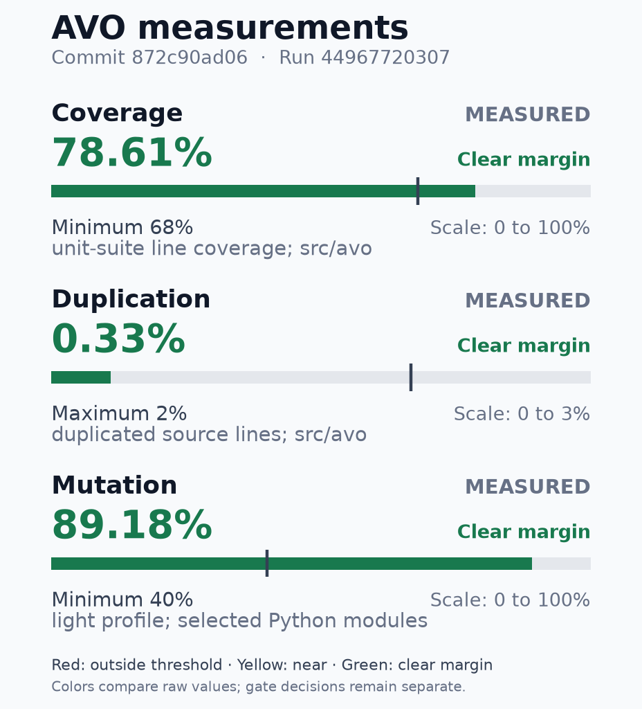

# Quality metrics

Release readout of the exact commit and CI run. Measurements and thresholds do not replace mandatory checks.

| Field | Value |
|---|---|
| Version | 1.23.0 |
| Tag | v1.23.0 |
| SHA | `872c90ad06b3a39f4b5c03ecce8d5f10db910599` |
| Recorded (UTC) | 2026-11-22T00:59:02Z |

## AVO quality

**Overall: PASS**

Commit: `872c90ad06b3a39f4b5c03ecce8d5f10db910599` · Run: `44967720307`

PR head: `Unavailable`
PR base: `Unavailable`
Tested revision: `872c90ad06b3a39f4b5c03ecce8d5f10db910599`
Attempt: 1. Passed producer evidence may come from earlier attempts of the same run.

All mandatory gate decisions and required jobs passed.

**Measurements**

Evidence completeness: 9 measured, 1 partial, 1 unavailable. Gate decisions are below.

Unavailable evidence: Safety branch coverage.

| Metric | Measured | Scope | Evidence |
|---|---|---|---|
| Line coverage | 78.61% | unit suite; src/avo | 51,295/65,252 executable lines [coverage.json](https://github.com/joaobispo2077/avo/actions/runs/44967720307/artifacts/14732319553) (SHA-256 `89cd4b1fa000`) |
| Duplication | 0.33% | source lines; src/avo | 460/140,130 duplicated lines; 46 clone pairs [jscpd/jscpd-report.json](https://github.com/joaobispo2077/avo/actions/runs/44967720307/artifacts/14732319553) (SHA-256 `61a287df2c56`) |
| Mutation efficacy | 89.18% | light profile; selected Python modules | 536 killed / 65 survived / 601 total; 0 unresolved [mutation-metrics.json](https://github.com/joaobispo2077/avo/actions/runs/44967720307/artifacts/14732194045) (SHA-256 `1dd704be367e`) |

### Mutation efficacy by source

PARTIAL: Scope counters reconcile; some efficacy measurements are unavailable.
Existing mutation enforcement applies to the aggregate profile. Source colors and the aggregate floor line are informational comparisons.

Aggregate: 536 killed / 65 survived / 601 total; 0 unresolved. Complete execution: True.

Source excerpt: 5/5. Missing/incomplete first, then lowest measured efficacy; M IDs sort by full source path.

| Source ID and full path | Efficacy / state | Actual outcome counts |
|---|---|---|
| M005: [src/avo/validate_usability.py](https://github.com/joaobispo2077/avo/blob/872c90ad06b3a39f4b5c03ecce8d5f10db910599/src/avo/validate_usability.py) | Zero mutants; efficacy unavailable. | 0 killed / 0 survived / 0 total; 0 unresolved |
| M002: [src/avo/mcp/bridge.py](https://github.com/joaobispo2077/avo/blob/872c90ad06b3a39f4b5c03ecce8d5f10db910599/src/avo/mcp/bridge.py) | 68.80% | 86 killed / 39 survived / 125 total; 0 unresolved |
| M001: [src/avo/adapters/registry.py](https://github.com/joaobispo2077/avo/blob/872c90ad06b3a39f4b5c03ecce8d5f10db910599/src/avo/adapters/registry.py) | 89.09% | 49 killed / 6 survived / 55 total; 0 unresolved |
| M004: [src/avo/validate_dependencies.py](https://github.com/joaobispo2077/avo/blob/872c90ad06b3a39f4b5c03ecce8d5f10db910599/src/avo/validate_dependencies.py) | 95.23% | 379 killed / 19 survived / 398 total; 0 unresolved |
| M003: [src/avo/mcp/registry.py](https://github.com/joaobispo2077/avo/blob/872c90ad06b3a39f4b5c03ecce8d5f10db910599/src/avo/mcp/registry.py) | 95.65% | 22 killed / 1 survived / 23 total; 0 unresolved |

[Complete mutation source index and outcome proof (text archive)](kpi-detail:mutation-efficacy.md)

### Complexity and CRAP review

6333 observed functions; 6275 measured CRAP; 58 observed functions unmeasured; 0 source-analysis errors. Total population known.
CRAP reference 30 is informational. Existing complexity policy and exceptions remain separate.

**Cyclomatic complexity: 10/6333 eligible candidates shown**. highest observed values, capped at 10; ties: descending value, then canonical path, definition line, qualified name.

| ID | Full source identity | Observed value | Unit |
|---|---|---:|---|
| U0236 | [src/avo/adapters/media/audio_tracks.py:61 compile_continuous_audio_graph](https://github.com/joaobispo2077/avo/blob/872c90ad06b3a39f4b5c03ecce8d5f10db910599/src/avo/adapters/media/audio_tracks.py#L61) | 51 | independent paths |
| U6221 | [src/avo/validate_edl.py:119 _bluray_ps5_semantic_errors](https://github.com/joaobispo2077/avo/blob/872c90ad06b3a39f4b5c03ecce8d5f10db910599/src/avo/validate_edl.py#L119) | 47 | independent paths |
| U5474 | [src/avo/timeline/proof_plan.py:968 ProofPlanCompiler.preflight](https://github.com/joaobispo2077/avo/blob/872c90ad06b3a39f4b5c03ecce8d5f10db910599/src/avo/timeline/proof_plan.py#L968) | 43 | independent paths |
| U3780 | [src/avo/timeline/approval_service.py:1199 ApprovalService.decide](https://github.com/joaobispo2077/avo/blob/872c90ad06b3a39f4b5c03ecce8d5f10db910599/src/avo/timeline/approval_service.py#L1199) | 41 | independent paths |
| U6226 | [src/avo/validate_edl.py:291 _comparison_semantic_errors](https://github.com/joaobispo2077/avo/blob/872c90ad06b3a39f4b5c03ecce8d5f10db910599/src/avo/validate_edl.py#L291) | 40 | independent paths |
| U6181 | [src/avo/update.py:282 run_update](https://github.com/joaobispo2077/avo/blob/872c90ad06b3a39f4b5c03ecce8d5f10db910599/src/avo/update.py#L282) | 39 | independent paths |
| U1557 | [src/avo/cli.py:1842 _review_batch](https://github.com/joaobispo2077/avo/blob/872c90ad06b3a39f4b5c03ecce8d5f10db910599/src/avo/cli.py#L1842) | 38 | independent paths |
| U4736 | [src/avo/timeline/iterations.py:327 IterationLedgerService.record_iteration](https://github.com/joaobispo2077/avo/blob/872c90ad06b3a39f4b5c03ecce8d5f10db910599/src/avo/timeline/iterations.py#L327) | 38 | independent paths |
| U6067 | [src/avo/timeline/vision_review.py:212 compile_review_coverage](https://github.com/joaobispo2077/avo/blob/872c90ad06b3a39f4b5c03ecce8d5f10db910599/src/avo/timeline/vision_review.py#L212) | 38 | independent paths |
| U3954 | [src/avo/timeline/command_handlers.py:98 CommandHandlers.execute](https://github.com/joaobispo2077/avo/blob/872c90ad06b3a39f4b5c03ecce8d5f10db910599/src/avo/timeline/command_handlers.py#L98) | 37 | independent paths |

**CRAP: 10/6275 eligible candidates shown**. highest observed values, capped at 10; ties: descending value, then canonical path, definition line, qualified name.

| ID | Full source identity | Observed value | Unit |
|---|---|---:|---|
| U6221 | [src/avo/validate_edl.py:119 _bluray_ps5_semantic_errors](https://github.com/joaobispo2077/avo/blob/872c90ad06b3a39f4b5c03ecce8d5f10db910599/src/avo/validate_edl.py#L119) | 2256 | CRAP score |
| U6226 | [src/avo/validate_edl.py:291 _comparison_semantic_errors](https://github.com/joaobispo2077/avo/blob/872c90ad06b3a39f4b5c03ecce8d5f10db910599/src/avo/validate_edl.py#L291) | 1640 | CRAP score |
| U1557 | [src/avo/cli.py:1842 _review_batch](https://github.com/joaobispo2077/avo/blob/872c90ad06b3a39f4b5c03ecce8d5f10db910599/src/avo/cli.py#L1842) | 1482 | CRAP score |
| U5273 | [src/avo/timeline/pipeline.py:954 TimelinePipeline.advance](https://github.com/joaobispo2077/avo/blob/872c90ad06b3a39f4b5c03ecce8d5f10db910599/src/avo/timeline/pipeline.py#L954) | 735.738 | CRAP score |
| U1088 | [src/avo/adapters/understand/watch_skill.py:721 execute_bounded_passes](https://github.com/joaobispo2077/avo/blob/872c90ad06b3a39f4b5c03ecce8d5f10db910599/src/avo/adapters/understand/watch_skill.py#L721) | 600 | CRAP score |
| U5955 | [src/avo/timeline/stills.py:182 StillExtractionService.extract](https://github.com/joaobispo2077/avo/blob/872c90ad06b3a39f4b5c03ecce8d5f10db910599/src/avo/timeline/stills.py#L182) | 552 | CRAP score |
| U1118 | [src/avo/adapters/understand/watch_skill.py:1381 _native_review](https://github.com/joaobispo2077/avo/blob/872c90ad06b3a39f4b5c03ecce8d5f10db910599/src/avo/adapters/understand/watch_skill.py#L1381) | 501.235 | CRAP score |
| U1519 | [src/avo/cli.py:718 _sync](https://github.com/joaobispo2077/avo/blob/872c90ad06b3a39f4b5c03ecce8d5f10db910599/src/avo/cli.py#L718) | 462 | CRAP score |
| U2435 | [src/avo/final_transcript_artifacts.py:25 _word_cues](https://github.com/joaobispo2077/avo/blob/872c90ad06b3a39f4b5c03ecce8d5f10db910599/src/avo/final_transcript_artifacts.py#L25) | 272 | CRAP score |
| U1572 | [src/avo/cli.py:2333 _proof](https://github.com/joaobispo2077/avo/blob/872c90ad06b3a39f4b5c03ecce8d5f10db910599/src/avo/cli.py#L2333) | 261.201 | CRAP score |

[Complete function index: hotspots.md (text archive)](kpi-detail:hotspots.md)

### File coupling: CE / CA

359 actual files at 117 positions; 1453 distinct internal module edges; 1 namespace containers excluded from file points.
CE is horizontal (uses others); CA is vertical (used by others). Median references: CE 3, CA 2; all measured actual files including isolates, equality on the lower side. Spacing: piecewise log2(1 + count) around raw median; ticks show raw counts. Equal-area halves use independent scales around each median; equal areas do not mean equal numeric ranges. Regions describe connectivity, not architectural health or gate status.

Lookup excerpt: 13/117 coordinate groups; 66/359 files. Groups ordered by CE then CA; all members of each shown group are retained.

Indexed positions and files (bidirectional lookup)

| Position | CE | CA | Members | File ID and complete source identity |
|---|---:|---:|---:|---|
| G01 | 0 | 0 | 24 | F003: [src/avo/adapters/__init__.py](https://github.com/joaobispo2077/avo/blob/872c90ad06b3a39f4b5c03ecce8d5f10db910599/src/avo/adapters/__init__.py) |
| G01 | 0 | 0 | 24 | F017: [src/avo/adapters/media/__init__.py](https://github.com/joaobispo2077/avo/blob/872c90ad06b3a39f4b5c03ecce8d5f10db910599/src/avo/adapters/media/__init__.py) |
| G01 | 0 | 0 | 24 | F054: [src/avo/adapters/motion/__init__.py](https://github.com/joaobispo2077/avo/blob/872c90ad06b3a39f4b5c03ecce8d5f10db910599/src/avo/adapters/motion/__init__.py) |
| G01 | 0 | 0 | 24 | F058: [src/avo/adapters/qc/__init__.py](https://github.com/joaobispo2077/avo/blob/872c90ad06b3a39f4b5c03ecce8d5f10db910599/src/avo/adapters/qc/__init__.py) |
| G01 | 0 | 0 | 24 | F068: [src/avo/adapters/stubs/__init__.py](https://github.com/joaobispo2077/avo/blob/872c90ad06b3a39f4b5c03ecce8d5f10db910599/src/avo/adapters/stubs/__init__.py) |
| G01 | 0 | 0 | 24 | F074: [src/avo/adapters/transcribe/__init__.py](https://github.com/joaobispo2077/avo/blob/872c90ad06b3a39f4b5c03ecce8d5f10db910599/src/avo/adapters/transcribe/__init__.py) |
| G01 | 0 | 0 | 24 | F078: [src/avo/adapters/understand/__init__.py](https://github.com/joaobispo2077/avo/blob/872c90ad06b3a39f4b5c03ecce8d5f10db910599/src/avo/adapters/understand/__init__.py) |
| G01 | 0 | 0 | 24 | F080: [src/avo/adapters/understand/clap_embeddings_worker.py](https://github.com/joaobispo2077/avo/blob/872c90ad06b3a39f4b5c03ecce8d5f10db910599/src/avo/adapters/understand/clap_embeddings_worker.py) |
| G01 | 0 | 0 | 24 | F082: [src/avo/adapters/understand/cutting_alignment_worker.py](https://github.com/joaobispo2077/avo/blob/872c90ad06b3a39f4b5c03ecce8d5f10db910599/src/avo/adapters/understand/cutting_alignment_worker.py) |
| G01 | 0 | 0 | 24 | F087: [src/avo/adapters/understand/visual_motion_worker.py](https://github.com/joaobispo2077/avo/blob/872c90ad06b3a39f4b5c03ecce8d5f10db910599/src/avo/adapters/understand/visual_motion_worker.py) |
| G01 | 0 | 0 | 24 | F121: [src/avo/direction/__init__.py](https://github.com/joaobispo2077/avo/blob/872c90ad06b3a39f4b5c03ecce8d5f10db910599/src/avo/direction/__init__.py) |
| G01 | 0 | 0 | 24 | F135: [src/avo/engine_install.py](https://github.com/joaobispo2077/avo/blob/872c90ad06b3a39f4b5c03ecce8d5f10db910599/src/avo/engine_install.py) |
| G01 | 0 | 0 | 24 | F137: [src/avo/generate_sfx.py](https://github.com/joaobispo2077/avo/blob/872c90ad06b3a39f4b5c03ecce8d5f10db910599/src/avo/generate_sfx.py) |
| G01 | 0 | 0 | 24 | F142: [src/avo/library/__init__.py](https://github.com/joaobispo2077/avo/blob/872c90ad06b3a39f4b5c03ecce8d5f10db910599/src/avo/library/__init__.py) |
| G01 | 0 | 0 | 24 | F176: [src/avo/pack_transcripts.py](https://github.com/joaobispo2077/avo/blob/872c90ad06b3a39f4b5c03ecce8d5f10db910599/src/avo/pack_transcripts.py) |
| G01 | 0 | 0 | 24 | F186: [src/avo/resources/artcraft/__init__.py](https://github.com/joaobispo2077/avo/blob/872c90ad06b3a39f4b5c03ecce8d5f10db910599/src/avo/resources/artcraft/__init__.py) |
| G01 | 0 | 0 | 24 | F187: [src/avo/resources/directions/__init__.py](https://github.com/joaobispo2077/avo/blob/872c90ad06b3a39f4b5c03ecce8d5f10db910599/src/avo/resources/directions/__init__.py) |
| G01 | 0 | 0 | 24 | F188: [src/avo/resources/interchange/__init__.py](https://github.com/joaobispo2077/avo/blob/872c90ad06b3a39f4b5c03ecce8d5f10db910599/src/avo/resources/interchange/__init__.py) |
| G01 | 0 | 0 | 24 | F213: [src/avo/srt_to_centered_ass.py](https://github.com/joaobispo2077/avo/blob/872c90ad06b3a39f4b5c03ecce8d5f10db910599/src/avo/srt_to_centered_ass.py) |
| G01 | 0 | 0 | 24 | F216: [src/avo/templates/__init__.py](https://github.com/joaobispo2077/avo/blob/872c90ad06b3a39f4b5c03ecce8d5f10db910599/src/avo/templates/__init__.py) |
| G01 | 0 | 0 | 24 | F218: [src/avo/templates/library_review/__init__.py](https://github.com/joaobispo2077/avo/blob/872c90ad06b3a39f4b5c03ecce8d5f10db910599/src/avo/templates/library_review/__init__.py) |
| G01 | 0 | 0 | 24 | F219: [src/avo/templates/shorts_hyperframes/__init__.py](https://github.com/joaobispo2077/avo/blob/872c90ad06b3a39f4b5c03ecce8d5f10db910599/src/avo/templates/shorts_hyperframes/__init__.py) |
| G01 | 0 | 0 | 24 | F220: [src/avo/timeline/__init__.py](https://github.com/joaobispo2077/avo/blob/872c90ad06b3a39f4b5c03ecce8d5f10db910599/src/avo/timeline/__init__.py) |
| G01 | 0 | 0 | 24 | F286: [src/avo/timeline/models.py](https://github.com/joaobispo2077/avo/blob/872c90ad06b3a39f4b5c03ecce8d5f10db910599/src/avo/timeline/models.py) |
| G02 | 0 | 1 | 11 | F040: [src/avo/adapters/media/proof_rendered_events.py](https://github.com/joaobispo2077/avo/blob/872c90ad06b3a39f4b5c03ecce8d5f10db910599/src/avo/adapters/media/proof_rendered_events.py) |
| G02 | 0 | 1 | 11 | F042: [src/avo/adapters/media/proof_stream.py](https://github.com/joaobispo2077/avo/blob/872c90ad06b3a39f4b5c03ecce8d5f10db910599/src/avo/adapters/media/proof_stream.py) |
| G02 | 0 | 1 | 11 | F059: [src/avo/adapters/qc/asset_review.py](https://github.com/joaobispo2077/avo/blob/872c90ad06b3a39f4b5c03ecce8d5f10db910599/src/avo/adapters/qc/asset_review.py) |
| G02 | 0 | 1 | 11 | F060: [src/avo/adapters/qc/code_drawn_review.py](https://github.com/joaobispo2077/avo/blob/872c90ad06b3a39f4b5c03ecce8d5f10db910599/src/avo/adapters/qc/code_drawn_review.py) |
| G02 | 0 | 1 | 11 | F109: [src/avo/consume_mode.py](https://github.com/joaobispo2077/avo/blob/872c90ad06b3a39f4b5c03ecce8d5f10db910599/src/avo/consume_mode.py) |
| G02 | 0 | 1 | 11 | F138: [src/avo/grade.py](https://github.com/joaobispo2077/avo/blob/872c90ad06b3a39f4b5c03ecce8d5f10db910599/src/avo/grade.py) |
| G02 | 0 | 1 | 11 | F139: [src/avo/hardware.py](https://github.com/joaobispo2077/avo/blob/872c90ad06b3a39f4b5c03ecce8d5f10db910599/src/avo/hardware.py) |
| G02 | 0 | 1 | 11 | F165: [src/avo/mcp/request_state.py](https://github.com/joaobispo2077/avo/blob/872c90ad06b3a39f4b5c03ecce8d5f10db910599/src/avo/mcp/request_state.py) |
| G02 | 0 | 1 | 11 | F198: [src/avo/shorts_captions.py](https://github.com/joaobispo2077/avo/blob/872c90ad06b3a39f4b5c03ecce8d5f10db910599/src/avo/shorts_captions.py) |
| G02 | 0 | 1 | 11 | F258: [src/avo/timeline/editor_feedback.py](https://github.com/joaobispo2077/avo/blob/872c90ad06b3a39f4b5c03ecce8d5f10db910599/src/avo/timeline/editor_feedback.py) |
| G02 | 0 | 1 | 11 | F338: [src/avo/timeline/sync.py](https://github.com/joaobispo2077/avo/blob/872c90ad06b3a39f4b5c03ecce8d5f10db910599/src/avo/timeline/sync.py) |
| G03 | 0 | 2 | 7 | F096: [src/avo/audio_preview.py](https://github.com/joaobispo2077/avo/blob/872c90ad06b3a39f4b5c03ecce8d5f10db910599/src/avo/audio_preview.py) |
| G03 | 0 | 2 | 7 | F106: [src/avo/build_captions.py](https://github.com/joaobispo2077/avo/blob/872c90ad06b3a39f4b5c03ecce8d5f10db910599/src/avo/build_captions.py) |
| G03 | 0 | 2 | 7 | F160: [src/avo/mcp/__init__.py](https://github.com/joaobispo2077/avo/blob/872c90ad06b3a39f4b5c03ecce8d5f10db910599/src/avo/mcp/__init__.py) |
| G03 | 0 | 2 | 7 | F249: [src/avo/timeline/cutting_profiles.py](https://github.com/joaobispo2077/avo/blob/872c90ad06b3a39f4b5c03ecce8d5f10db910599/src/avo/timeline/cutting_profiles.py) |
| G03 | 0 | 2 | 7 | F256: [src/avo/timeline/diff.py](https://github.com/joaobispo2077/avo/blob/872c90ad06b3a39f4b5c03ecce8d5f10db910599/src/avo/timeline/diff.py) |
| G03 | 0 | 2 | 7 | F341: [src/avo/timeline/track_rules.py](https://github.com/joaobispo2077/avo/blob/872c90ad06b3a39f4b5c03ecce8d5f10db910599/src/avo/timeline/track_rules.py) |
| G03 | 0 | 2 | 7 | F347: [src/avo/timeline_view.py](https://github.com/joaobispo2077/avo/blob/872c90ad06b3a39f4b5c03ecce8d5f10db910599/src/avo/timeline_view.py) |
| G04 | 0 | 3 | 2 | F048: [src/avo/adapters/media/still_probe.py](https://github.com/joaobispo2077/avo/blob/872c90ad06b3a39f4b5c03ecce8d5f10db910599/src/avo/adapters/media/still_probe.py) |
| G04 | 0 | 3 | 2 | F217: [src/avo/templates/code_drawn/__init__.py](https://github.com/joaobispo2077/avo/blob/872c90ad06b3a39f4b5c03ecce8d5f10db910599/src/avo/templates/code_drawn/__init__.py) |
| G05 | 0 | 5 | 2 | F103: [src/avo/breath_control.py](https://github.com/joaobispo2077/avo/blob/872c90ad06b3a39f4b5c03ecce8d5f10db910599/src/avo/breath_control.py) |
| G05 | 0 | 5 | 2 | F210: [src/avo/shorts_rules.py](https://github.com/joaobispo2077/avo/blob/872c90ad06b3a39f4b5c03ecce8d5f10db910599/src/avo/shorts_rules.py) |
| G06 | 0 | 6 | 1 | F191: [src/avo/settings.py](https://github.com/joaobispo2077/avo/blob/872c90ad06b3a39f4b5c03ecce8d5f10db910599/src/avo/settings.py) |
| G07 | 0 | 8 | 1 | F235: [src/avo/timeline/command_registry.py](https://github.com/joaobispo2077/avo/blob/872c90ad06b3a39f4b5c03ecce8d5f10db910599/src/avo/timeline/command_registry.py) |
| G08 | 0 | 9 | 1 | F098: [src/avo/audio_restoration.py](https://github.com/joaobispo2077/avo/blob/872c90ad06b3a39f4b5c03ecce8d5f10db910599/src/avo/audio_restoration.py) |
| G09 | 0 | 12 | 2 | F031: [src/avo/adapters/media/local_source.py](https://github.com/joaobispo2077/avo/blob/872c90ad06b3a39f4b5c03ecce8d5f10db910599/src/avo/adapters/media/local_source.py) |
| G09 | 0 | 12 | 2 | F297: [src/avo/timeline/ports.py](https://github.com/joaobispo2077/avo/blob/872c90ad06b3a39f4b5c03ecce8d5f10db910599/src/avo/timeline/ports.py) |
| G10 | 0 | 16 | 1 | F288: [src/avo/timeline/motion_metadata.py](https://github.com/joaobispo2077/avo/blob/872c90ad06b3a39f4b5c03ecce8d5f10db910599/src/avo/timeline/motion_metadata.py) |
| G11 | 0 | 18 | 1 | F266: [src/avo/timeline/event_clock.py](https://github.com/joaobispo2077/avo/blob/872c90ad06b3a39f4b5c03ecce8d5f10db910599/src/avo/timeline/event_clock.py) |
| G12 | 0 | 40 | 1 | F177: [src/avo/paths.py](https://github.com/joaobispo2077/avo/blob/872c90ad06b3a39f4b5c03ecce8d5f10db910599/src/avo/paths.py) |
| G13 | 1 | 0 | 12 | F001: [src/avo/__init__.py](https://github.com/joaobispo2077/avo/blob/872c90ad06b3a39f4b5c03ecce8d5f10db910599/src/avo/__init__.py) |
| G13 | 1 | 0 | 12 | F002: [src/avo/__main__.py](https://github.com/joaobispo2077/avo/blob/872c90ad06b3a39f4b5c03ecce8d5f10db910599/src/avo/__main__.py) |
| G13 | 1 | 0 | 12 | F069: [src/avo/adapters/stubs/memory_ai_memory.py](https://github.com/joaobispo2077/avo/blob/872c90ad06b3a39f4b5c03ecce8d5f10db910599/src/avo/adapters/stubs/memory_ai_memory.py) |
| G13 | 1 | 0 | 12 | F070: [src/avo/adapters/stubs/motion_hyperframes.py](https://github.com/joaobispo2077/avo/blob/872c90ad06b3a39f4b5c03ecce8d5f10db910599/src/avo/adapters/stubs/motion_hyperframes.py) |
| G13 | 1 | 0 | 12 | F071: [src/avo/adapters/stubs/motion_remotion.py](https://github.com/joaobispo2077/avo/blob/872c90ad06b3a39f4b5c03ecce8d5f10db910599/src/avo/adapters/stubs/motion_remotion.py) |
| G13 | 1 | 0 | 12 | F072: [src/avo/adapters/stubs/plan_speckit.py](https://github.com/joaobispo2077/avo/blob/872c90ad06b3a39f4b5c03ecce8d5f10db910599/src/avo/adapters/stubs/plan_speckit.py) |
| G13 | 1 | 0 | 12 | F097: [src/avo/audio_qc.py](https://github.com/joaobispo2077/avo/blob/872c90ad06b3a39f4b5c03ecce8d5f10db910599/src/avo/audio_qc.py) |
| G13 | 1 | 0 | 12 | F161: [src/avo/mcp/__main__.py](https://github.com/joaobispo2077/avo/blob/872c90ad06b3a39f4b5c03ecce8d5f10db910599/src/avo/mcp/__main__.py) |
| G13 | 1 | 0 | 12 | F179: [src/avo/prepare_transcription.py](https://github.com/joaobispo2077/avo/blob/872c90ad06b3a39f4b5c03ecce8d5f10db910599/src/avo/prepare_transcription.py) |
| G13 | 1 | 0 | 12 | F246: [src/avo/timeline/cutting_evaluation.py](https://github.com/joaobispo2077/avo/blob/872c90ad06b3a39f4b5c03ecce8d5f10db910599/src/avo/timeline/cutting_evaluation.py) |
| G13 | 1 | 0 | 12 | F349: [src/avo/transcribe_batch.py](https://github.com/joaobispo2077/avo/blob/872c90ad06b3a39f4b5c03ecce8d5f10db910599/src/avo/transcribe_batch.py) |
| G13 | 1 | 0 | 12 | F353: [src/avo/validate_usability.py](https://github.com/joaobispo2077/avo/blob/872c90ad06b3a39f4b5c03ecce8d5f10db910599/src/avo/validate_usability.py) |

[Complete bidirectional file index: coupling-index.md (text archive)](kpi-detail:coupling-index.md)

**Findings and accepted debt**

- Dependency findings: PASS, 0 critical, 0 high, 16 moderate, 0 low (MEASURED). [npm-audit-summary.json](https://github.com/joaobispo2077/avo/actions/runs/44967720307/artifacts/14732319553) (SHA-256 `a546db397281`); [deps-findings.json](https://github.com/joaobispo2077/avo/actions/runs/44967720307/artifacts/14732319553) (SHA-256 `c4769a32b091`); [pip-audit-raw.json](https://github.com/joaobispo2077/avo/actions/runs/44967720307/artifacts/14732319553) (SHA-256 `0900d73575fb`); [npm-audit-raw.json](https://github.com/joaobispo2077/avo/actions/runs/44967720307/artifacts/14732319553) (SHA-256 `6c6d564ef905`)
- Dead-code findings: 142 reported; 0 unwaived (MEASURED). [deadcode.json](https://github.com/joaobispo2077/avo/actions/runs/44967720307/artifacts/14732319553) (SHA-256 `1e625403e4b1`)
- Import boundaries: 8 kept; 0 broken (MEASURED). [gates/architecture/gate.json](https://github.com/joaobispo2077/avo/actions/runs/44967720307/artifacts/14732319553) (SHA-256 `d6248d01d4b4`); [gates/architecture/gate.log](https://github.com/joaobispo2077/avo/actions/runs/44967720307/artifacts/14732319553) (SHA-256 `5714fd091eac`)
- Dependency hoist plan: 27 proposed package changes (MEASURED). [dependency-tree.json](https://github.com/joaobispo2077/avo/actions/runs/44967720307/artifacts/14732319553) (SHA-256 `5a04bd75a48f`)
- complexity: 163 configured entries; 163 matched findings; 163 unique affected path/name identities; stale: 0; 0 unwaived findings. Groups are non-additive; these counts are not defect removal.
- deadcode: 142 configured entries; 142 matched findings; 142 unique affected path/name identities; stale: 0; 0 unwaived findings. Groups are non-additive; these counts are not defect removal.

**Executed test evidence**

- repo-integration-tests: 483 passed / 0 failed / 0 errors / 56 skipped; 539 testcase events. MEASURED. Repeated events are not additional unique tests.
- repo-unit-tests: 7494 passed / 0 failed / 0 errors / 22 skipped; 7516 testcase events. MEASURED. Repeated events are not additional unique tests.

**Gate decisions**

Status badges are categorical. Missing execution proof cannot certify a recorded PASS; recorded results stay labeled separately. Required jobs are listed separately below.

[Complete gate decisions and proof (text archive)](kpi-detail:gate-decisions.md)

| Gate | Decision | Policy | Execution evidence |
|---|---|---|---|
| Lint | **PASS** | Ruff (&#96;src/avo&#96;, &#96;tests&#96;, &#96;helpers&#96;) + ESLint | Captured exit 0. Numeric finding count not exported.. [gates/lint/gate.json](https://github.com/joaobispo2077/avo/actions/runs/44967720307/artifacts/14732319553) (SHA-256 `b4a7a62f4fc7`); [gates/lint/gate.log](https://github.com/joaobispo2077/avo/actions/runs/44967720307/artifacts/14732319553) (SHA-256 `1237e674bddf`) |
| Format | **PASS** | Ruff format --check + Prettier --check | Captured exit 0. Numeric finding count not exported.. [gates/format/gate.json](https://github.com/joaobispo2077/avo/actions/runs/44967720307/artifacts/14732319553) (SHA-256 `331888373af9`); [gates/format/gate.log](https://github.com/joaobispo2077/avo/actions/runs/44967720307/artifacts/14732319553) (SHA-256 `6dfef4c3cb15`) |
| Coverage | **PASS** | pytest-cov fail-under on &#96;src/avo&#96;; Minimum 68%; comparison rounded to 0 decimal places | 78.61% · 51,295/65,252 executable lines. [gates/coverage/gate.json](https://github.com/joaobispo2077/avo/actions/runs/44967720307/artifacts/14732319553) (SHA-256 `160f609cd8d6`); [gates/coverage/gate.log](https://github.com/joaobispo2077/avo/actions/runs/44967720307/artifacts/14732319553) (SHA-256 `aeab9bf14b0a`) |
| Complexity | **PASS** | xenon max-absolute **B** · Ruff C901 ≤ 31 | 0 unwaived · 163 observed accepted findings. [gates/complexity/gate.json](https://github.com/joaobispo2077/avo/actions/runs/44967720307/artifacts/14732319553) (SHA-256 `3c113f0baf32`); [gates/complexity/gate.log](https://github.com/joaobispo2077/avo/actions/runs/44967720307/artifacts/14732319553) (SHA-256 `8c1d5d86d11a`) |
| Dependency audit | **PASS · yellow** | pip-audit on dev + MCP; unwaived Python advisories and npm critical block (&#96;deps-audit-allowlist.json&#96;); high or moderate is a yellow PASS, low-only or clean is a green PASS; the metric names each high package | PASS, 0 critical, 0 high, 16 moderate, 0 low. [gates/deps/gate.json](https://github.com/joaobispo2077/avo/actions/runs/44967720307/artifacts/14732319553) (SHA-256 `ee0efc992dd0`); [gates/deps/gate.log](https://github.com/joaobispo2077/avo/actions/runs/44967720307/artifacts/14732319553) (SHA-256 `6f69979b5de9`) |
| Dead code | **PASS** | vulture confidence ≥ 60 (&#96;deadcode-allowlist.json&#96;) | 142 reported; 0 unwaived. [gates/deadcode/gate.json](https://github.com/joaobispo2077/avo/actions/runs/44967720307/artifacts/14732319553) (SHA-256 `ce1a44afdba0`); [gates/deadcode/gate.log](https://github.com/joaobispo2077/avo/actions/runs/44967720307/artifacts/14732319553) (SHA-256 `967b8e6ad3ba`) |
| Duplication | **PASS** | jscpd on &#96;src/avo&#96;; Maximum 2% | 0.33% · 460/140,130 duplicated lines; 46 clone pairs. [gates/duplication/gate.json](https://github.com/joaobispo2077/avo/actions/runs/44967720307/artifacts/14732319553) (SHA-256 `92bd0005caff`); [gates/duplication/gate.log](https://github.com/joaobispo2077/avo/actions/runs/44967720307/artifacts/14732319553) (SHA-256 `71400018f683`) |
| Architecture | **PASS** | import-linter (&#96;.importlinter&#96;) | 8 kept; 0 broken. [gates/architecture/gate.json](https://github.com/joaobispo2077/avo/actions/runs/44967720307/artifacts/14732319553) (SHA-256 `d6248d01d4b4`); [gates/architecture/gate.log](https://github.com/joaobispo2077/avo/actions/runs/44967720307/artifacts/14732319553) (SHA-256 `5714fd091eac`) |
| Dependency tree | **PASS** | npm find-dupes · command fail blocks · hoist plan report-only | 27 proposed package changes · 1 additions / 6 removals / 20 changes; not applied. [gates/tree/gate.json](https://github.com/joaobispo2077/avo/actions/runs/44967720307/artifacts/14732319553) (SHA-256 `461fcd607d95`); [gates/tree/gate.log](https://github.com/joaobispo2077/avo/actions/runs/44967720307/artifacts/14732319553) (SHA-256 `859b9398c699`) |
| Mutation | **PASS** | Complete accounting; Minimum 40%; light profile; selected Python modules | [mutation-metrics.json](https://github.com/joaobispo2077/avo/actions/runs/44967720307/artifacts/14732194045) (SHA-256 `1dd704be367e`) |

Execution results

| Required job | Result | Test evidence |
|---|---|---|
| ci-readiness | **SUCCESS** | Job result; testcase counts not captured. Not captured |
| mutation-light | **SUCCESS** | Job result; testcase counts not captured. Not captured |
| prerequisites-gate | **SUCCESS** | Job result; testcase counts not captured. Not captured |
| repo-integration-tests | **SUCCESS** | 483 passed / 0 failed / 0 errors / 56 skipped; 539 JUnit testcases. MEASURED: Counts from actual native JUnit testcase events. [integration-tests.xml](https://github.com/joaobispo2077/avo/actions/runs/44967720307/artifacts/14732831945) (SHA-256 `b3c719fbfc49`); [gates/integration-tests/gate.log](https://github.com/joaobispo2077/avo/actions/runs/44967720307/artifacts/14732831945) (SHA-256 `8dfb94011967`) |
| repo-unit-tests | **SUCCESS** | 7494 passed / 0 failed / 0 errors / 22 skipped; 7516 JUnit testcases. MEASURED: Counts from actual native JUnit testcase events. [unit-tests.xml](https://github.com/joaobispo2077/avo/actions/runs/44967720307/artifacts/14732727661) (SHA-256 `19dc5ec754b4`); [gates/unit-tests/gate.log](https://github.com/joaobispo2077/avo/actions/runs/44967720307/artifacts/14732727661) (SHA-256 `617cfea0660d`) |
| software-quality | **SUCCESS** | Job result; testcase counts not captured. Not captured |
| usability-gate | **SUCCESS** | Job result; testcase counts not captured. Not captured |

Recorded skip/failure reasons: 30/56 non-passing testcase events shown; complete events and full reasons remain in the raw JUnit evidence.

| Suite / case | Outcome | Recorded reason |
|---|---|---|
| pytest:tests.integration.test_artcraft_app_qualification:test_native_photocraft_retains_an_editable_image_for_review | skipped | set AVO_ARTCRAFT_PHOTOCRAFT_TEST_CLI to the installed Windows PhotoCraft 0.23.1 CLI /home/runner/work/avo/avo/tests/integration/test_artcraft_app_qualification.py:106: set AVO_ARTCRAFT_PHOTOCRAFT_TEST_CLI to the installed Windows PhotoCraft 0.23.1 CLI |
| pytest:tests.integration.test_face_anchor_flow:test_actual_detector_preserves_source_sample_identity_and_marks_disappearance | skipped | Explicit prepared visual runtime pin required /home/runner/work/avo/avo/tests/integration/test_face_anchor_flow.py:29: Explicit prepared visual runtime pin required |
| pytest:tests.integration.test_artcraft_app_qualification:test_native_figcraft_retains_editable_layout_and_prototype_for_review | skipped | set AVO_ARTCRAFT_FIGCRAFT_TEST_CLI to the installed Windows FigCraft 0.18.1 CLI /home/runner/work/avo/avo/tests/integration/test_artcraft_app_qualification.py:162: set AVO_ARTCRAFT_FIGCRAFT_TEST_CLI to the installed Windows FigCraft 0.18.1 CLI |
| pytest:tests.integration.test_artcraft_app_qualification:test_native_deckcraft_retains_master_and_transition_for_static_review | skipped | set AVO_ARTCRAFT_DECKCRAFT_TEST_CLI to the installed Windows DeckCraft 0.18.1 CLI /home/runner/work/avo/avo/tests/integration/test_artcraft_app_qualification.py:226: set AVO_ARTCRAFT_DECKCRAFT_TEST_CLI to the installed Windows DeckCraft 0.18.1 CLI |
| pytest:tests.integration.test_artcraft_app_qualification:test_native_lightcraft_recovers_isolated_treatment_from_snapshot | skipped | set AVO_ARTCRAFT_LIGHTCRAFT_TEST_CLI to the installed Windows LightCraft 0.21.1 CLI /home/runner/work/avo/avo/tests/integration/test_artcraft_app_qualification.py:255: set AVO_ARTCRAFT_LIGHTCRAFT_TEST_CLI to the installed Windows LightCraft 0.21.1 CLI |
| pytest:tests.integration.test_artcraft_app_qualification:test_native_effectcraft_reopens_mask_and_renders_exact_partial_span | skipped | set AVO_ARTCRAFT_EFFECTCRAFT_TEST_CLI to the installed Windows EffectCraft 0.24.1 CLI /home/runner/work/avo/avo/tests/integration/test_artcraft_app_qualification.py:287: set AVO_ARTCRAFT_EFFECTCRAFT_TEST_CLI to the installed Windows EffectCraft 0.24.1 CLI |
| pytest:tests.integration.test_artcraft_app_qualification:test_native_vectorcraft_graph_data_survives_reopen_and_revision | skipped | Select the installed VectorCraft 0.24.1 CLI /home/runner/work/avo/avo/tests/integration/test_artcraft_app_qualification.py:331: Select the installed VectorCraft 0.24.1 CLI |
| pytest:tests.integration.test_face_anchor_flow:test_prepared_proxy_cannot_use_unverified_bytes | skipped | Explicit prepared visual runtime pin required /home/runner/work/avo/avo/tests/integration/test_face_anchor_flow.py:84: Explicit prepared visual runtime pin required |
| pytest:tests.integration.test_face_anchor_flow:test_actual_face_measurements_drive_encoded_window_and_hold_after_loss | skipped | Explicit prepared visual runtime pin required /home/runner/work/avo/avo/tests/integration/test_face_anchor_flow.py:96: Explicit prepared visual runtime pin required |
| pytest:tests.integration.test_face_anchor_flow:test_original_source_decoder_keeps_native_frames_and_range\[0\] | skipped | Explicit prepared visual runtime pin required /home/runner/work/avo/avo/tests/integration/test_face_anchor_flow.py:200: Explicit prepared visual runtime pin required |
| pytest:tests.integration.test_face_anchor_flow:test_original_source_decoder_keeps_native_frames_and_range\[5\] | skipped | Explicit prepared visual runtime pin required /home/runner/work/avo/avo/tests/integration/test_face_anchor_flow.py:200: Explicit prepared visual runtime pin required |
| pytest:tests.integration.test_artcraft_audio_runtime:test_installed_soundcraft_saved_cue_reopens_with_exact_stereo_pcm | skipped | set AVO_ARTCRAFT_SOUNDCRAFT_TEST_CLI to the installed 0.20.1 CLI /home/runner/work/avo/avo/tests/integration/test_artcraft_audio_runtime.py:55: set AVO_ARTCRAFT_SOUNDCRAFT_TEST_CLI to the installed 0.20.1 CLI |
| pytest:tests.integration.test_artcraft_audio_runtime:test_native_soundcraft_cue_mixes_once_under_original_dialogue\[cue-only\] | skipped | set AVO_ARTCRAFT_SOUNDCRAFT_TEST_CLI to the installed 0.20.1 CLI /home/runner/work/avo/avo/tests/integration/test_artcraft_audio_runtime.py:55: set AVO_ARTCRAFT_SOUNDCRAFT_TEST_CLI to the installed 0.20.1 CLI |
| pytest:tests.integration.test_artcraft_audio_runtime:test_native_soundcraft_cue_mixes_once_under_original_dialogue\[lower-third-with-cue\] | skipped | set AVO_ARTCRAFT_SOUNDCRAFT_TEST_CLI to the installed 0.20.1 CLI /home/runner/work/avo/avo/tests/integration/test_artcraft_audio_runtime.py:55: set AVO_ARTCRAFT_SOUNDCRAFT_TEST_CLI to the installed 0.20.1 CLI |
| pytest:tests.integration.test_artcraft_emblem_runtime:test_native_vector_emblem_becomes_an_editable_animation_and_proof_asset | skipped | Select the installed VectorCraft 0.24.1 and AniCraft 0.2.1 CLIs /home/runner/work/avo/avo/tests/integration/test_artcraft_emblem_runtime.py:56: Select the installed VectorCraft 0.24.1 and AniCraft 0.2.1 CLIs |
| pytest:tests.integration.test_artcraft_emblem_runtime:test_emblem_and_optional_sound_render_through_one_original_footage_proof | skipped | Select the installed VectorCraft 0.24.1 and AniCraft 0.2.1 CLIs /home/runner/work/avo/avo/tests/integration/test_artcraft_emblem_runtime.py:56: Select the installed VectorCraft 0.24.1 and AniCraft 0.2.1 CLIs |
| pytest:tests.integration.test_artcraft_filmcraft_runtime:test_native_filmcraft_returns_exact_source_timeline_for_sync_review | skipped | set AVO_ARTCRAFT_FILMCRAFT_TEST_CLI to the installed 0.20.1 CLI /home/runner/work/avo/avo/tests/integration/test_artcraft_filmcraft_runtime.py:29: set AVO_ARTCRAFT_FILMCRAFT_TEST_CLI to the installed 0.20.1 CLI |
| pytest:tests.integration.test_artcraft_lower_third_runtime:test_installed_anicraft_portrait_lower_third_uses_safe_mobile_placement | skipped | set AVO_ARTCRAFT_ANICRAFT_TEST_CLI to the installed AniCraft 0.2.1 CLI /home/runner/work/avo/avo/tests/integration/test_artcraft_lower_third_runtime.py:44: set AVO_ARTCRAFT_ANICRAFT_TEST_CLI to the installed AniCraft 0.2.1 CLI |
| pytest:tests.integration.test_artcraft_lower_third_runtime:test_installed_anicraft_revises_both_selected_text_slots\[640-360-False\] | skipped | Select the installed AniCraft 0.2.1 CLI /home/runner/work/avo/avo/tests/integration/test_artcraft_lower_third_runtime.py:103: Select the installed AniCraft 0.2.1 CLI |
| pytest:tests.integration.test_artcraft_lower_third_runtime:test_installed_anicraft_revises_both_selected_text_slots\[360-640-False\] | skipped | Select the installed AniCraft 0.2.1 CLI /home/runner/work/avo/avo/tests/integration/test_artcraft_lower_third_runtime.py:103: Select the installed AniCraft 0.2.1 CLI |
| pytest:tests.integration.test_artcraft_lower_third_runtime:test_installed_anicraft_revises_both_selected_text_slots\[360-640-True\] | skipped | Select the installed AniCraft 0.2.1 CLI /home/runner/work/avo/avo/tests/integration/test_artcraft_lower_third_runtime.py:103: Select the installed AniCraft 0.2.1 CLI |
| pytest:tests.integration.test_artcraft_lower_third_runtime:test_installed_anicraft_saves_reopens_and_reconstructs_a_transparent_label | skipped | set AVO_ARTCRAFT_ANICRAFT_TEST_CLI to the installed AniCraft 0.2.1 CLI /home/runner/work/avo/avo/tests/integration/test_artcraft_lower_third_runtime.py:216: set AVO_ARTCRAFT_ANICRAFT_TEST_CLI to the installed AniCraft 0.2.1 CLI |
| pytest:tests.integration.test_artcraft_lower_third_runtime:test_installed_anicraft_guided_job_round_trips_through_avo_commands | skipped | set AVO_ARTCRAFT_ANICRAFT_TEST_CLI to the installed AniCraft 0.2.1 CLI /home/runner/work/avo/avo/tests/integration/test_artcraft_lower_third_runtime.py:456: set AVO_ARTCRAFT_ANICRAFT_TEST_CLI to the installed AniCraft 0.2.1 CLI |
| pytest:tests.integration.test_artcraft_lower_third_runtime:test_installed_anicraft_overlay_contributes_to_full_and_window_proofs\[cli\] | skipped | set AVO_ARTCRAFT_ANICRAFT_TEST_CLI to the installed AniCraft 0.2.1 CLI /home/runner/work/avo/avo/tests/integration/test_artcraft_lower_third_runtime.py:699: set AVO_ARTCRAFT_ANICRAFT_TEST_CLI to the installed AniCraft 0.2.1 CLI |
| pytest:tests.integration.test_artcraft_lower_third_runtime:test_installed_anicraft_overlay_contributes_to_full_and_window_proofs\[json-lines\] | skipped | set AVO_ARTCRAFT_ANICRAFT_TEST_CLI to the installed AniCraft 0.2.1 CLI /home/runner/work/avo/avo/tests/integration/test_artcraft_lower_third_runtime.py:699: set AVO_ARTCRAFT_ANICRAFT_TEST_CLI to the installed AniCraft 0.2.1 CLI |
| pytest:tests.integration.test_artcraft_modes_runtime:test_installed_anicraft_mcp_handoff_writes_an_inspectable_headless_source | skipped | set AVO_ARTCRAFT_ANICRAFT_TEST_CLI to the installed 0.2.1 CLI /home/runner/work/avo/avo/tests/integration/test_artcraft_modes_runtime.py:25: set AVO_ARTCRAFT_ANICRAFT_TEST_CLI to the installed 0.2.1 CLI |
| pytest:tests.integration.test_artcraft_modes_runtime:test_installed_anicraft_json_lines_and_cli_produce_the_same_export | skipped | set AVO_ARTCRAFT_ANICRAFT_TEST_CLI to the installed 0.2.1 CLI /home/runner/work/avo/avo/tests/integration/test_artcraft_modes_runtime.py:25: set AVO_ARTCRAFT_ANICRAFT_TEST_CLI to the installed 0.2.1 CLI |
| pytest:tests.integration.test_artcraft_recovery_runtime:test_installed_anicraft_save_is_retained_when_the_runner_loses_its_reply | skipped | Select the installed AniCraft 0.2.1 CLI /home/runner/work/avo/avo/tests/integration/test_artcraft_recovery_runtime.py:36: Select the installed AniCraft 0.2.1 CLI |
| pytest:tests.integration.test_artcraft_recovery_runtime:test_installed_anicraft_stale_source_reports_the_edited_title_through_cli | skipped | Select the installed AniCraft 0.2.1 CLI /home/runner/work/avo/avo/tests/integration/test_artcraft_recovery_runtime.py:36: Select the installed AniCraft 0.2.1 CLI |
| pytest:tests.integration.test_artcraft_recovery_runtime:test_reconstruction_retains_native_source_for_a_fresh_installed_render | skipped | Select the installed AniCraft 0.2.1 CLI /home/runner/work/avo/avo/tests/integration/test_artcraft_recovery_runtime.py:36: Select the installed AniCraft 0.2.1 CLI |

Recorded skip/failure reasons: 22/22 non-passing testcase events shown; complete events and full reasons remain in the raw JUnit evidence.

| Suite / case | Outcome | Recorded reason |
|---|---|---|
| pytest:tests.acceptance.test_editing_craft_performance:test_20_minute_150_item_warm_motion_review | skipped | Requires explicit metadata-performance exercise on a declared machine /home/runner/work/avo/avo/tests/acceptance/test_editing_craft_performance.py:246: Requires explicit metadata-performance exercise on a declared machine |
| pytest:tests.acceptance.test_editing_craft_performance:test_5000_indexed_sfx_warm_descriptor_search | skipped | Requires explicit metadata-performance exercise on a declared machine /home/runner/work/avo/avo/tests/acceptance/test_editing_craft_performance.py:277: Requires explicit metadata-performance exercise on a declared machine |
| pytest:tests.acceptance.test_library_comprehension:test_five_creators_can_read_the_folder_proposal | skipped | Requires actual five-person comprehension study results /home/runner/work/avo/avo/tests/acceptance/test_library_comprehension.py:10: Requires actual five-person comprehension study results |
| pytest:tests.test_optional_embedding_packaging:test_actual_frozen_collector_includes_external_worker_source_bytes | skipped | could not import 'PyInstaller': No module named 'PyInstaller' /home/runner/work/avo/avo/tests/test_optional_embedding_packaging.py:81: could not import 'PyInstaller': No module named 'PyInstaller' |
| pytest:tests.test_reference_motion_analysis:test_reference_motion_uses_actual_proxy_and_abstains_in_darkness | skipped | Explicit prepared OpenCV runtime required /home/runner/work/avo/avo/tests/test_reference_motion_analysis.py:114: Explicit prepared OpenCV runtime required |
| pytest:tests.test_reference_motion_analysis:test_reference_motion_discloses_cut_and_untrackable_blur | skipped | Explicit prepared OpenCV runtime required /home/runner/work/avo/avo/tests/test_reference_motion_analysis.py:142: Explicit prepared OpenCV runtime required |
| pytest:tests.test_reference_motion_analysis:test_motion_in_one_subject_area_does_not_establish_camera_movement | skipped | Explicit prepared OpenCV runtime required /home/runner/work/avo/avo/tests/test_reference_motion_analysis.py:172: Explicit prepared OpenCV runtime required |
| pytest:tests.test_cost_mcp:test_sdk_cost_arguments_require_structured_payload_and_drop_cli_overrides\[context-descriptor\] | skipped | could not import 'mcp.server.mcpserver.tools.base': No module named 'mcp' /home/runner/work/avo/avo/tests/test_cost_mcp.py:83: could not import 'mcp.server.mcpserver.tools.base': No module named 'mcp' |
| pytest:tests.test_cost_mcp:test_sdk_cost_arguments_require_structured_payload_and_drop_cli_overrides\[observe-packet\] | skipped | could not import 'mcp.server.mcpserver.tools.base': No module named 'mcp' /home/runner/work/avo/avo/tests/test_cost_mcp.py:83: could not import 'mcp.server.mcpserver.tools.base': No module named 'mcp' |
| pytest:tests.test_cost_mcp:test_sdk_cost_arguments_require_structured_payload_and_drop_cli_overrides\[transition-request\] | skipped | could not import 'mcp.server.mcpserver.tools.base': No module named 'mcp' /home/runner/work/avo/avo/tests/test_cost_mcp.py:83: could not import 'mcp.server.mcpserver.tools.base': No module named 'mcp' |
| pytest:tests.test_cost_mcp:test_sdk_cost_arguments_require_structured_payload_and_drop_cli_overrides\[estimate-request\] | skipped | could not import 'mcp.server.mcpserver.tools.base': No module named 'mcp' /home/runner/work/avo/avo/tests/test_cost_mcp.py:83: could not import 'mcp.server.mcpserver.tools.base': No module named 'mcp' |
| pytest:tests.test_cost_mcp:test_sdk_cost_arguments_require_structured_payload_and_drop_cli_overrides\[reconcile-reconciliation\] | skipped | could not import 'mcp.server.mcpserver.tools.base': No module named 'mcp' /home/runner/work/avo/avo/tests/test_cost_mcp.py:83: could not import 'mcp.server.mcpserver.tools.base': No module named 'mcp' |
| pytest:tests.test_software_foundation.SoftwareFoundationTests:test_claude_foundation_skills_exist | skipped | .cursor/.claude dev tooling is gitignored in public checkouts /home/runner/work/avo/avo/tests/test_software_foundation.py:65: .cursor/.claude dev tooling is gitignored in public checkouts |
| pytest:tests.test_software_foundation.SoftwareFoundationTests:test_cursor_foundation_rules_exist | skipped | .cursor/.claude dev tooling is gitignored in public checkouts /home/runner/work/avo/avo/tests/test_software_foundation.py:44: .cursor/.claude dev tooling is gitignored in public checkouts |
| pytest:tests.test_software_foundation.SoftwareFoundationTests:test_cursor_skills_mirrored | skipped | .cursor/.claude dev tooling is gitignored in public checkouts /home/runner/work/avo/avo/tests/test_software_foundation.py:73: .cursor/.claude dev tooling is gitignored in public checkouts |
| pytest:tests.test_engine_packaging:test_frozen_motion_review_templates_are_collected_from_the_package | skipped | could not import 'PyInstaller': No module named 'PyInstaller' /home/runner/work/avo/avo/tests/test_engine_packaging.py:169: could not import 'PyInstaller': No module named 'PyInstaller' |
| pytest:tests.test_master_artifacts:test_legacy_windows_stem_matching_remains_case_insensitive | skipped | legacy Windows glob is case-insensitive /home/runner/work/avo/avo/tests/test_master_artifacts.py:80: legacy Windows glob is case-insensitive |
| pytest:tests.test_mcp_bridge:test_register_cli_tools_on_server | skipped | could not import 'mcp': No module named 'mcp' /home/runner/work/avo/avo/tests/test_mcp_bridge.py:428: could not import 'mcp': No module named 'mcp' |
| pytest:tests.test_mcp_meta:test_registered_meta_tools_on_server | skipped | could not import 'mcp': No module named 'mcp' /home/runner/work/avo/avo/tests/test_mcp_meta.py:102: could not import 'mcp': No module named 'mcp' |
| pytest:tests.test_mcp_package:test_create_server_registers_meta_and_all_cli_tools | skipped | could not import 'mcp': No module named 'mcp' /home/runner/work/avo/avo/tests/test_mcp_package.py:70: could not import 'mcp': No module named 'mcp' |
| pytest:tests.test_timeline_import_relink:test_directory_junction_is_not_followed_outside_declared_root | skipped | Windows junction boundary /home/runner/work/avo/avo/tests/test_timeline_import_relink.py:364: Windows junction boundary |
| pytest:tests.test_timeline_import_media:test_local_reference_forms_resolve_same_unicode_file_within_authorized_root\[wsl\] | skipped | Windows mount spelling is meaningful only on Windows /home/runner/work/avo/avo/tests/test_timeline_import_media.py:192: Windows mount spelling is meaningful only on Windows |

Successful execution is not a measured quality score. Uncaptured counts remain unavailable.

[Run logs and downloadable artifacts](https://github.com/joaobispo2077/avo/actions/runs/44967720307)

Diagnostic excerpt omitted for publication size. Complete observations and reasons remain in normalized JSON and linked text artifacts.

