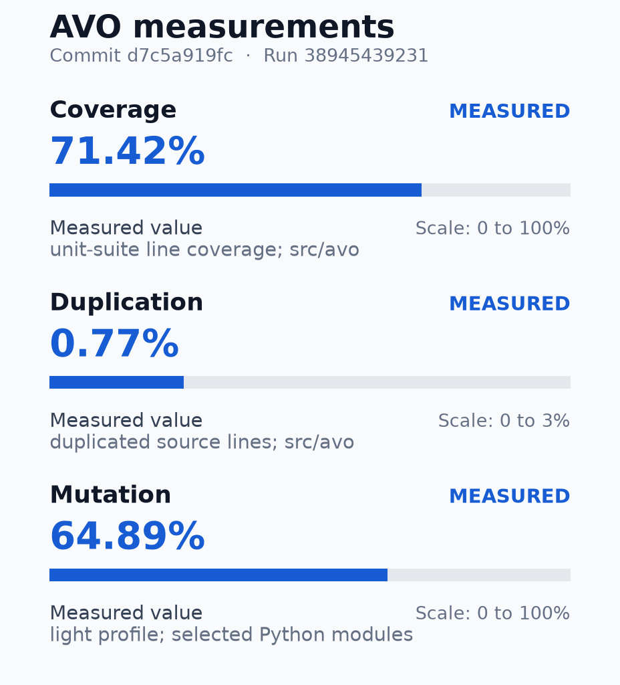

# Quality metrics

Release readout of the exact commit and CI run. Measurements and thresholds do not replace mandatory checks.

| Field | Value |
|---|---|
| Version | 1.15.0 |
| Tag | v1.15.0 |
| SHA | `d7c5a919fcb6559fa3e06ee00086bfad743e027f` |
| Recorded (UTC) | 2026-10-16T18:26:39Z |

## AVO quality

**Overall: PASS**

Commit: `d7c5a919fcb6559fa3e06ee00086bfad743e027f` · Run: `38945439231`

All mandatory gate decisions and required jobs passed.

**Measurements**

Evidence completeness: 9 measured, 1 partial, 1 unavailable. Gate decisions are below.

| Metric | Measured | Scope | Evidence |
|---|---|---|---|
| Line coverage | 71.42% | unit suite; src/avo | 18,421/25,794 executable lines [coverage.json](https://github.com/joaobispo2077/avo/actions/runs/38945439231/artifacts/12065887999) (SHA-256 `eb6572bc7309`) |
| Duplication | 0.77% | source lines; src/avo | 440/56,949 duplicated lines; 41 clone pairs [jscpd/jscpd-report.json](https://github.com/joaobispo2077/avo/actions/runs/38945439231/artifacts/12065887999) (SHA-256 `bef53dd643f6`) |
| Mutation efficacy | 64.89% | light profile; selected Python modules | 207 killed / 112 survived / 319 total; 0 unresolved [mutation-metrics.json](https://github.com/joaobispo2077/avo/actions/runs/38945439231/artifacts/12066940895) (SHA-256 `275dab2328f1`) |
| Cyclomatic complexity | Maximum 51; 2277 functions | Python functions and methods; src/avo | Actual cyclomatic complexity; function locations and existing debt reasons below. [code-risk.json](https://github.com/joaobispo2077/avo/actions/runs/38945439231/artifacts/12065887999) (SHA-256 `cafcd0366514`) |
| CRAP | Max observed 2450.00; 192 above reference 30 (partial) | same-run function line coverage and complexity; src/avo | 2227/2277 observed functions joined; 0 source-analysis errors. CC² × (1 − function line coverage)³ + CC. Reference 30 is informational. [code-risk.json](https://github.com/joaobispo2077/avo/actions/runs/38945439231/artifacts/12065887999) (SHA-256 `cafcd0366514`) |
| Coupling (CA / CE) | Maximum CA 21 / CE 14; 73 packages | static internal imports; avo.<package> | 191 distinct internal edges; dynamic and intra-package imports not measured. [code-risk.json](https://github.com/joaobispo2077/avo/actions/runs/38945439231/artifacts/12065887999) (SHA-256 `cafcd0366514`) |
| Dependency findings | 0 blocking; npm 0 critical / 2 high / 7 moderate / 0 low | frozen Python dev + MCP; npm lock | Captured finding summaries; unwaived Python advisories and npm criticals block. Both raw audits completed; other npm severities are reported. [npm-audit-summary.json](https://github.com/joaobispo2077/avo/actions/runs/38945439231/artifacts/12065887999) (SHA-256 `e7a80b307070`); [deps-findings.json](https://github.com/joaobispo2077/avo/actions/runs/38945439231/artifacts/12065887999) (SHA-256 `c4769a32b091`); [pip-audit-raw.json](https://github.com/joaobispo2077/avo/actions/runs/38945439231/artifacts/12065887999) (SHA-256 `00799b9026a2`); [npm-audit-raw.json](https://github.com/joaobispo2077/avo/actions/runs/38945439231/artifacts/12065887999) (SHA-256 `8ae7284cb65f`) |
| Dead-code findings | 150 reported; 0 unwaived | Vulture confidence >=60; src/avo | Actual analyzer findings; documented exceptions listed separately. [deadcode.json](https://github.com/joaobispo2077/avo/actions/runs/38945439231/artifacts/12065887999) (SHA-256 `719d1e37f64f`) |
| Import boundaries | 5 kept; 0 broken | import-linter contracts; avo | Actual executed contract results, not configured contract count. [gates/architecture/gate.json](https://github.com/joaobispo2077/avo/actions/runs/38945439231/artifacts/12065887999) (SHA-256 `b44930f956d0`); [gates/architecture/gate.log](https://github.com/joaobispo2077/avo/actions/runs/38945439231/artifacts/12065887999) (SHA-256 `c75ea970fe22`) |
| Dependency hoist plan | 24 proposed package changes | npm lock; dry run | 1 additions / 6 removals / 17 changes; not applied [dependency-tree.json](https://github.com/joaobispo2077/avo/actions/runs/38945439231/artifacts/12065887999) (SHA-256 `018e187972f7`) |
| Safety branch coverage | Unavailable | selected safety modules; separate scheduled run | The PR line profile does not instrument branches. The scheduled safety report has its own commit/run identity. Not captured |

**Gate decisions**

| Gate | Decision | Policy | Execution evidence |
|---|---|---|---|
| Lint | **PASS** | Ruff (`src/avo`, `tests`, `helpers`) + ESLint | [gates/lint/gate.json](https://github.com/joaobispo2077/avo/actions/runs/38945439231/artifacts/12065887999) (SHA-256 `f691cc483e9b`); [gates/lint/gate.log](https://github.com/joaobispo2077/avo/actions/runs/38945439231/artifacts/12065887999) (SHA-256 `1237e674bddf`) |
| Format | **PASS** | Ruff format --check + Prettier --check | [gates/format/gate.json](https://github.com/joaobispo2077/avo/actions/runs/38945439231/artifacts/12065887999) (SHA-256 `b708ee99e72f`); [gates/format/gate.log](https://github.com/joaobispo2077/avo/actions/runs/38945439231/artifacts/12065887999) (SHA-256 `78bee841a195`) |
| Coverage | **PASS** | pytest-cov fail-under on `src/avo`; Minimum 68%; comparison rounded to 0 decimal places | [gates/coverage/gate.json](https://github.com/joaobispo2077/avo/actions/runs/38945439231/artifacts/12065887999) (SHA-256 `93c03f7891b5`); [gates/coverage/gate.log](https://github.com/joaobispo2077/avo/actions/runs/38945439231/artifacts/12065887999) (SHA-256 `a2d69f9f1ad3`) |
| Complexity | **PASS** | xenon max-absolute **B** · Ruff C901 ≤ 31 | [gates/complexity/gate.json](https://github.com/joaobispo2077/avo/actions/runs/38945439231/artifacts/12065887999) (SHA-256 `7381b0b497df`); [gates/complexity/gate.log](https://github.com/joaobispo2077/avo/actions/runs/38945439231/artifacts/12065887999) (SHA-256 `238c15c415f3`) |
| Dependency audit | **PASS** | pip-audit on dev + MCP; unwaived Python advisories and npm critical block (`deps-audit-allowlist.json`); npm high/moderate/low reported | [gates/deps/gate.json](https://github.com/joaobispo2077/avo/actions/runs/38945439231/artifacts/12065887999) (SHA-256 `57ae9cd06fa9`); [gates/deps/gate.log](https://github.com/joaobispo2077/avo/actions/runs/38945439231/artifacts/12065887999) (SHA-256 `a830f70b6dd3`) |
| Dead code | **PASS** | vulture confidence ≥ 60 (`deadcode-allowlist.json`) | [gates/deadcode/gate.json](https://github.com/joaobispo2077/avo/actions/runs/38945439231/artifacts/12065887999) (SHA-256 `7eda897d3788`); [gates/deadcode/gate.log](https://github.com/joaobispo2077/avo/actions/runs/38945439231/artifacts/12065887999) (SHA-256 `283a1f4d327c`) |
| Duplication | **PASS** | jscpd on `src/avo`; Maximum 2% | [gates/duplication/gate.json](https://github.com/joaobispo2077/avo/actions/runs/38945439231/artifacts/12065887999) (SHA-256 `9278472f8d94`); [gates/duplication/gate.log](https://github.com/joaobispo2077/avo/actions/runs/38945439231/artifacts/12065887999) (SHA-256 `1319949fe320`) |
| Architecture | **PASS** | import-linter (`.importlinter`) | [gates/architecture/gate.json](https://github.com/joaobispo2077/avo/actions/runs/38945439231/artifacts/12065887999) (SHA-256 `b44930f956d0`); [gates/architecture/gate.log](https://github.com/joaobispo2077/avo/actions/runs/38945439231/artifacts/12065887999) (SHA-256 `c75ea970fe22`) |
| Dependency tree | **PASS** | npm find-dupes · command fail blocks · hoist plan report-only | [gates/tree/gate.json](https://github.com/joaobispo2077/avo/actions/runs/38945439231/artifacts/12065887999) (SHA-256 `e03390d81a0e`); [gates/tree/gate.log](https://github.com/joaobispo2077/avo/actions/runs/38945439231/artifacts/12065887999) (SHA-256 `1e379d9100f1`) |
| Mutation | **PASS** | Complete accounting; Minimum 40%; light profile; selected Python modules | [mutation-metrics.json](https://github.com/joaobispo2077/avo/actions/runs/38945439231/artifacts/12066940895) (SHA-256 `275dab2328f1`) |

Execution results

| Required job | Result | Test evidence |
|---|---|---|
| ci-readiness | **SUCCESS** | Job result; testcase counts not captured. Not captured |
| mutation-light | **SUCCESS** | Job result; testcase counts not captured. Not captured |
| prerequisites-gate | **SUCCESS** | Job result; testcase counts not captured. Not captured |
| repo-integration-tests | **SUCCESS** | 114 passed / 0 failed / 0 errors / 1 skipped; 115 JUnit testcases. MEASURED: Counts from actual native JUnit testcase events. [integration-tests.xml](https://github.com/joaobispo2077/avo/actions/runs/38945439231/artifacts/12064444738) (SHA-256 `c8798f69e6ab`); [gates/integration-tests/gate.log](https://github.com/joaobispo2077/avo/actions/runs/38945439231/artifacts/12064444738) (SHA-256 `e6fa3d2ee88c`) |
| repo-unit-tests | **SUCCESS** | 1980 passed / 0 failed / 0 errors / 6 skipped; 1986 JUnit testcases. MEASURED: Counts from actual native JUnit testcase events. [unit-tests.xml](https://github.com/joaobispo2077/avo/actions/runs/38945439231/artifacts/12067570299) (SHA-256 `ef9e98a75c18`); [gates/unit-tests/gate.log](https://github.com/joaobispo2077/avo/actions/runs/38945439231/artifacts/12067570299) (SHA-256 `cf6891ee63f0`) |
| software-quality | **SUCCESS** | Job result; testcase counts not captured. Not captured |
| usability-gate | **SUCCESS** | Job result; testcase counts not captured. Not captured |

Successful execution is not a measured quality score. Uncaptured counts remain unavailable.

[Run logs and downloadable artifacts](https://github.com/joaobispo2077/avo/actions/runs/38945439231)

Metric diagnostics and artifacts

CRAP reference 30 is informational. These are the highest observed function scores; unmatched functions remain unmeasured.

| Function | CC | Function line coverage | CRAP |
|---|---:|---:|---:|
| [src/avo/validate_edl.py:110 _bluray_ps5_semantic_errors](https://github.com/joaobispo2077/avo/blob/d7c5a919fcb6559fa3e06ee00086bfad743e027f/src/avo/validate_edl.py#L110) | 49 | 0.00% | 2450.00 |
| [src/avo/validate_edl.py:289 _comparison_semantic_errors](https://github.com/joaobispo2077/avo/blob/d7c5a919fcb6559fa3e06ee00086bfad743e027f/src/avo/validate_edl.py#L289) | 42 | 0.00% | 1806.00 |
| [src/avo/cli.py:1030 _review_batch](https://github.com/joaobispo2077/avo/blob/d7c5a919fcb6559fa3e06ee00086bfad743e027f/src/avo/cli.py#L1030) | 38 | 0.00% | 1482.00 |
| [src/avo/adapters/understand/watch_skill.py:1125 _native_review](https://github.com/joaobispo2077/avo/blob/d7c5a919fcb6559fa3e06ee00086bfad743e027f/src/avo/adapters/understand/watch_skill.py#L1125) | 29 | 0.00% | 870.00 |
| [src/avo/timeline/pipeline.py:572 TimelinePipeline.advance](https://github.com/joaobispo2077/avo/blob/d7c5a919fcb6559fa3e06ee00086bfad743e027f/src/avo/timeline/pipeline.py#L572) | 36 | 18.57% | 735.74 |
| [src/avo/adapters/qc/cut_proof.py:80 CutProofQcAdapter.check](https://github.com/joaobispo2077/avo/blob/d7c5a919fcb6559fa3e06ee00086bfad743e027f/src/avo/adapters/qc/cut_proof.py#L80) | 26 | 0.00% | 702.00 |
| [src/avo/render.py:1259 main](https://github.com/joaobispo2077/avo/blob/d7c5a919fcb6559fa3e06ee00086bfad743e027f/src/avo/render.py#L1259) | 32 | 14.89% | 663.23 |
| [src/avo/adapters/understand/watch_skill.py:717 execute_bounded_passes](https://github.com/joaobispo2077/avo/blob/d7c5a919fcb6559fa3e06ee00086bfad743e027f/src/avo/adapters/understand/watch_skill.py#L717) | 24 | 0.00% | 600.00 |
| [src/avo/audio_analysis.py:320 main](https://github.com/joaobispo2077/avo/blob/d7c5a919fcb6559fa3e06ee00086bfad743e027f/src/avo/audio_analysis.py#L320) | 24 | 0.00% | 600.00 |
| [src/avo/timeline/stills.py:182 StillExtractionService.extract](https://github.com/joaobispo2077/avo/blob/d7c5a919fcb6559fa3e06ee00086bfad743e027f/src/avo/timeline/stills.py#L182) | 23 | 0.00% | 552.00 |

Static package coupling is a review signal. Intra-package and dynamic imports are not measured; no quadrant cutoffs or abstractness score are adopted.

| Package | CA (used by) | CE (depends on) | Instability |
|---|---:|---:|---:|
| `avo.timeline` | 15 | 11 | 0.423 |
| `avo.adapters` | 7 | 14 | 0.667 |
| `avo.paths` | 21 | 0 | 0.000 |
| `avo.avo_state` | 13 | 1 | 0.071 |
| `avo.render` | 3 | 11 | 0.786 |
| `avo.video_context` | 3 | 10 | 0.769 |
| `avo.model_sources` | 5 | 7 | 0.583 |
| `avo.project_inventory` | 5 | 7 | 0.583 |
| `avo.cli` | 1 | 9 | 0.900 |
| `avo.init_project` | 7 | 3 | 0.300 |

Exception lists and contract definitions are configuration. Observed findings, source locations, waiver reasons, full function tables, raw audits and capture logs are retained in the linked artifacts.

